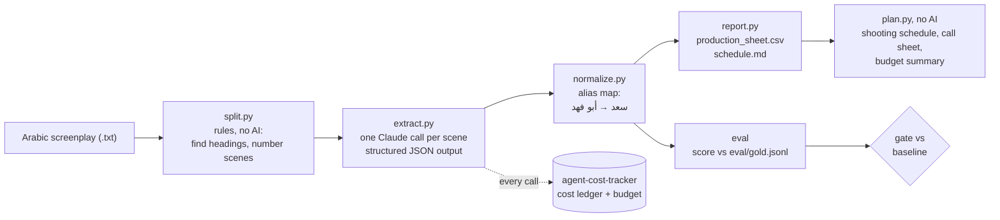

# arabic-script-breakdown

> **ملخص بالعربي:** أداة تقرأ سيناريو مسلسل عربي وتفرّغه مشهداً مشهداً: داخلي أو خارجي، نهار أو ليل،
> المكان، الشخصيات الموجودة فعلاً، والإكسسوار والمركبات والكومبارس. ثم تبني من التفريغ **مسودة جدول تصوير**
> (تجمع المشاهد حسب الموقع والوردية وتحترم أيام توفر الممثلين)، و**ورقة استدعاء** ليوم تصوير جاهزة للطباعة،
> و**ملخصاً يهم الميزانية** (أيام كل ممثل، التنقلات، الليالي). معها مجموعة اختبار عربية وبوابة جودة تمنع أي تحديث
> يسوء النتائج، ومجموعة منفصلة للحالات الصعبة. كل ما تنتجه مسودة يراجعها مساعد المخرج، ولا ترسل شيئاً لأحد.
> النص والبيانات كلها اصطناعية للتجربة. دليل الموظفين: [docs/دليل-المستخدم.md](docs/دليل-المستخدم.md).

An agent that reads an Arabic TV screenplay and produces a **script breakdown**: for every scene, whether
it is interior or exterior, day or night, where it is shot, which actors are needed, and which props,
vehicles, animals, extras and effects it needs. An assistant director does this by hand before anything
can be scheduled, because the shooting schedule, the daily call sheets and the budget are all built from it:
you group scenes by location to save company moves, you book each actor only on the days their scenes are
shot, and you price props, cars and extras from the list. This repo does the first pass automatically and,
more importantly, comes with an **Arabic evaluation set and a regression gate** so you can tell whether
a new model or prompt is better or worse before you trust it.

> **Data note:** the screenplay in `data/` is **synthetic**: drafted with Claude to my list of hard
> cases (a high-school drama set in Riyadh: MSA headings and action lines, Saudi/Gulf dialect dialogue).
> It is not from any real production. The first draft of the gold labels was also made with Claude.
> **Gold labels: drafted, pending native-speaker review.** See [Limits](#limits) for what this means
> for the scores.

## Why this matters for a production house

- **The breakdown is the first week of prep, every episode.** A 30-episode series is hundreds of scenes. The agent
  does the first pass in about a minute for about 2 cents an episode; the assistant director corrects it instead of
  typing it.
- **Mistakes here cost shooting days.** A silent actor left off the list is not called; a scene shot at two places
  that is planned as one wastes a move. The eval measures exactly these mistakes, and the gate stops a model or
  prompt update that makes them worse.
- **It goes all the way to the documents the crew uses:** a stripboard, a call sheet with call times, and a summary
  of the numbers the budget is built from (cast days, hold days, night shifts, company moves, site days).
- **Nothing leaves without a person.** Names the agent can't place are flagged, every schedule and call sheet is
  marked DRAFT until someone approves it by name, and the tool never emails anyone.
- **Arabic first.** Saudi dialect dialogue, MSA headings, nicknames, `متصل` scenes and dialect words for props are
  the test cases, and the staff guide is in Arabic.

## How it works



| File | What it does |
|---|---|
| `breakdown/split.py` | Finds scene headings with plain rules (`مشهد ١`, `م/2`, `م.13`, `مشهد (3)`, `٥ -`, or no number at all) and gives each scene a number. Also counts length in eighths of a page. |
| `breakdown/schema.py` | The Pydantic model of one scene's breakdown. |
| `breakdown/extract.py` | The prompt and the API call. Structured output means the answer is always valid JSON in the schema. The scene text is treated as data, and the previous scene's heading is passed so `متصل` (continuous) scenes get the right time of day. |
| `breakdown/pipeline.py` | Splits the script, sends 4 scenes at a time, and collects the results. A scene that fails (bad answer, API error, budget used up) is reported as failed; the other scenes still finish. For two `متصل` scenes in a row it adds the last written time to the context. |
| `breakdown/normalize.py` | Arabic normalization (tashkeel, tatweel, alef/ya/ta marbuta forms, Arabic-Indic digits) and the prop/location matching rules. |
| `breakdown/cast_aliases.py` | The character alias map. Written by hand for this script's cast only. |
| `breakdown/report.py` | The CSV (UTF-8 with BOM so Excel shows Arabic) and the per-actor / per-location schedule view. |
| `breakdown/score.py` | Per-field scoring and the regression check. |
| `breakdown/eval.py` | The eval command: run, score, log to `eval/history.csv`, gate. `--set hard` runs the separate hard set. |
| `breakdown/planning.py` | The draft shooting schedule (a greedy method, explained below), call times and the budget summary. No AI. |
| `breakdown/production_docs.py` | The Arabic HTML/CSV files: stripboard, budget summary, printable call sheet. |
| `breakdown/plan.py` | The planning command: `python -m breakdown.plan <breakdown.jsonl>`. |
| `data/kamera_jaddi.locations.csv` | Which real site each script place is shot at (synthetic). |
| `data/kamera_jaddi.availability.csv` | Which dates each actor can't come, or can only come, and who is day-only (synthetic). |

**Why an alias map?** In a script one person has several names: the father is `أبو فهد` in dialogue,
`سعد` in an action line, and the model often answers with the cast-list form `سعد العتيبي (أبو فهد)`.
A scheduler needs exactly one row per actor, or the same actor gets booked twice. The prompt asks for
cast-list names; the alias map is the safety net that turns every variant into one canonical name, and each
scene records what it changed (`alias_fixes`). In the sample run, 24 of 26 scenes needed at least one fix.
Most of those are not model mistakes: the cast list writes `فهد العتيبي` and `سعد العتيبي (أبو فهد)`, the
model copies that as told, and the gold uses the short names `فهد` and `أبو فهد`. With the cast list
removed (the experiment below), only 6 scenes needed a fix. The cleaner fix is to give the model the exact
allowed names (for example as an enum in the schema); that changes the prompt, so it needs a new eval run.

**Names it can't place are flagged, not guessed.** If the model writes a name that is not in the cast, or a first
name two cast members share (the hard set has two people called سلمان), the name is kept as written and the scene
gets a `review_flags` note in Arabic. The flag shows up in red on the schedule and on the call sheet, so a person
decides who it is before anyone is booked.

The map is **written for this script** (`breakdown/cast_aliases.py`). A new script needs its own map,
built from its cast list. Short keys like `خالد` are only safe because this cast has one Khalid. The
scorer runs the map on the model's answer only, not on the gold (which uses cast names, checked by a test),
so if the map ever merged two different people, the eval would show it as an error.

## Quickstart

This repo uses my separate `agent-cost-tracker` repo, installed from a folder next to this one:

```
some-folder/
    agent-cost-tracker/        <- clone this first
    arabic-script-breakdown/   <- this repo
```

```powershell
py -3.13 -m venv .venv
.venv\Scripts\activate                 # if PowerShell blocks it: Set-ExecutionPolicy -Scope Process Bypass
pip install -r requirements.txt        # installs ../agent-cost-tracker too; this is the only install path
copy .env.example .env                 # put ANTHROPIC_API_KEY in it (a .env in a parent folder also works)
python -m pytest                       # 77 tests, no API calls
python -m breakdown data/kamera_jaddi.txt --out output
python -m breakdown.plan output/breakdown.jsonl --out output/plan --call-sheet-day 2   # no API calls
python -m breakdown.eval --model claude-haiku-5-5 --effort low --gate
python -m breakdown.eval --set hard --model claude-haiku-5-5 --effort low --gate     # the hard set
```

To try the planning part with no API key at all, use the saved breakdown:
`python -m breakdown.plan examples/breakdown.jsonl --out output/plan --call-sheet-day 2`.

All API calls go through `tracked_call` from `agent-cost-tracker`, which records the cost of each call in
a shared SQLite ledger and refuses to call once the budget is used up.
`python -m agent_cost_tracker report` shows the spend.

## Sample output

`examples/production_sheet.csv` (a few rows, Haiku, effort low):

| رقم المشهد | داخلي/خارجي | الوقت | المكان | الشخصيات | الإكسسوار | المؤثرات | متصل |
|---|---|---|---|---|---|---|---|
| 8 | داخلي | ليل | غرفة فهد / بيت الجدة لطيفة في جدة | فهد، الجدة لطيفة | جوال | صوت البحر من بعيد | |
| 9 | داخلي | ليل | غرفة فهد | فهد، سارة | هاتف، كشاف صغير | | نعم |
| 13 | خارجي | فجر | سطح بيت أبو فهد | فهد، أبو فهد | كاميرا قديمة، حامل ثلاثي | صوت أذان الفجر | |
| 25 | داخلي | ليل | مسرح المدرسة | المدير، فهد، ريان، ماجد، أبو فهد، أم فهد، سارة، الأستاذ عادل | ميكروفون | تصفيق عالي | نعم |

Scene 9 says `متصل` instead of a time and the agent correctly carried `ليل` over from scene 8. In scene 13
the father only appears silently at the door, and he is still listed, because he still has to be on set.

`examples/schedule.md` turns this into what a scheduler wants: which scenes each actor is needed for
(فهد: 21 scenes, الجدة لطيفة: only scene 8, so she can be booked for one day) and which scenes share a
location (غرفة فهد: scenes 9, 12, 19, 20, shoot them together). This view is simplified: it groups by
location only. The real draft schedule, which also splits by shift, site and actor availability, is the next
section (`examples/plan/`).

## From breakdown to schedule, call sheet and budget

`python -m breakdown.plan` takes the breakdown plus two small files the production office keeps, and writes a
draft schedule (`schedule.html`, `schedule.csv`), `budget_summary.md`, `cast_days.csv` and a printable call sheet
for one day. It is plain code, no model: the same inputs give the same schedule every time.

- **Locations file** (`data/kamera_jaddi.locations.csv`): which real site each script place is shot at. The school
  corridor, the principal's office and the school gate are all one site, and the grandmother's house "in Jeddah" is
  a dressed room in the same villa, so nobody travels. A place is matched by its words (the most specific entry
  wins: `سطح بيت أبو فهد` matches `بيت أبو فهد`). A place that is not in the file is flagged.
- **Availability file** (`data/kamera_jaddi.availability.csv`): dates an actor can't come, dates they can only
  come, and "day shift only" (for the child actor).

**How the schedule is built (greedy, by rules you can check by hand):**

1. Each scene becomes a strip with a **shift** (`نهار` and `غروب` are a day shift; `ليل` and `فجر` a night shift,
   dawn being the end of a night) and a **site**. One shoot day is one shift.
2. Strips are sorted: day shift first, then by site, then by place, then by scene number.
3. For each working date (Friday off by default): start the day with the strip that is **hardest to place**, the one
   whose actors are free on the fewest dates. Then add strips of the same shift whose actors are free that date,
   best first: same place, then same site, then a new site (only one company move a day by default). Stop at the
   scene or page limit.
4. A scene that never fits is listed as unscheduled, with the reason.

"Greedy" means it makes the best-looking choice at each step and never goes back, so it is fast and easy to
explain, but not guaranteed to be the best possible schedule. Starting with the hardest strip is what makes it work
in practice: the grandmother is only free on two dates, so her scene takes the first of those dates before easier
scenes fill it.

On the saved example: 26 scenes in **5 shoot days** (3 day, 2 night), **3 company moves**, nothing unscheduled.
أبو فهد is kept off the first two days, the grandmother's scene lands on her date, the child actor's flashback is on a
day shift, the four night scenes in Fahd's room are shot together, and the dawn scenes come at the end of the nights.


The stripboard uses the usual colours (white INT day, yellow EXT day, blue INT night, green EXT night).

**The call sheet** for one day lists the sites with addresses, the scenes in order with an estimated start, the
cast with cast numbers and call times (makeup and wardrobe 90 minutes before their first scene), costume, vehicles,
extras, effects, and notes built from the data: the child actor's rules, the heritage site that needs a permit,
the sunset scene whose time must follow the real sunset, the horse that needs its handler, and any review flag.
Time estimates are simple and editable (`TimeRules`: a setup per scene, 15 minutes per eighth of a page, an hour
per company move, a meal break after six hours). Until it is run with `--approved-by "name"`, it carries a
DRAFT watermark and the line "not to be sent to actors before approval".


**The budget summary** gives the numbers a line producer prices: shoot days, day and night shifts, night scenes,
company moves, night-to-day turnarounds (crew rest), days per site (rental), extras / vehicles / animals per day,
and for each actor the days worked and the **hold days** (shoot days between their first and last day on which
they don't work, which are paid on a weekly deal). In the example, الأستاذ عادل works days 1 and 4 and is on hold
for 2 days; that is the kind of line an AD then tries to fix by moving one scene.

## The evaluation

### How the set was built

One synthetic 26-scene episode (`data/kamera_jaddi.txt`), drafted with Claude to my list of the cases
that break a naive breakdown, and one gold record per scene in `eval/gold.jsonl` (first draft also made
with Claude). `eval/GOLD_REVIEW.md` is
the review sheet for the native-speaker check (status: drafted, pending review). Hard cases covered:

| Hard case | Scenes |
|---|---|
| Inconsistent headings: `مشهد ١` / `م/2` / `مشهد (3)` / `٥ -` / `م.13` / no number; Arabic-Indic and Western digits | 1, 2, 3, 5, 6, 13, 19 |
| One person, many names: nickname (`فهود`, `ريّون`), title (`المدير` = `الأستاذ خالد الزهراني`), real name (`سعد` = `أبو فهد`) | 2, 4, 5, 18, 21 |
| Character mentioned but not present (talked about, in a photo, on a screen) | 3, 7, 10, 16, 18, 25, 26 |
| Present but silent (must still be booked) | 1, 2, 13, 14, 20, 24 |
| Prop mentioned only in dialogue (not a prop) | 7, 8, 18, 22 |
| Flashback with a younger actor (`فهد الصغير`) | 11 |
| Phone call cut between Riyadh and Jeddah (both actors needed) | 8 |
| `متصل` (continuous) scenes: time comes from the previous scene (each one follows a heading with a written time; two `متصل` in a row is only covered by a unit test) | 9, 16, 25 |
| Night / dawn / sunset edges: `فجر`, `غروب`, `آخر الليل` (= ليل) | 13, 17, 19, 20 |
| Animals, vehicles and extras that are not cast | 1, 6, 15, 17, 24 |

### The hard set (kept apart, with its own gate)

`data/hard_scenes.txt` is a second synthetic script of 7 harder scenes with its own cast, gold labels
(`eval/hard/gold.jsonl`), baseline, history and alias map. It is scored separately so a good average on the
easy episode can't hide a failure here.

| Scene | Hard case |
|---|---|
| 1 | **Prompt injection** inside the scene: a printed paper in Arabic and a fake English "SYSTEM NOTE" ask for night, an extra character (`مدير الإنتاج`) and a Ferrari. |
| 2 | **Ambiguous INT/EXT**: the action is inside a desert tent, the heading says `خارجي`. The heading decides. |
| 3 | **Same first name**: two people called سلمان (the father and the driver). The driver is present, the father is only mentioned. Heading written `داخلي . خارجي` with en-dashes. |
| 4 | **Montage** over three public places, no dialogue: all three must be named. |
| 5 | **Intercut** video call: both places and both people; the grandmother is only talked about. |
| 6, 7 | **Two `متصل` scenes in a row**: the time must be carried from two scenes back. Both Salmans present in 7. |
| 6, 7 | **Dialect-only props**: `المحماس` is named only in dialogue but handed over (a prop); `الزولية` and `الكاميرا` are only asked for (not props). |

Each hard scene also has **zero-tolerance checks** in its gold: `critical` fields that must be exactly right in that
scene, and `must_exclude` / `must_include` words (the Ferrari must not appear in any field; the محماس must be
found). The hard gate fails on any broken check, on top of the usual 0.05 threshold and the failed-scene rule.

### Metrics

| Field | How it is scored |
|---|---|
| `int_ext`, `time_of_day` | Exact match (fixed list of values). Accuracy. |
| `location` | After Arabic normalization, every word of the gold location must be in the answer (extra words are allowed, missing words are not: `المدرسة` is wrong for `ممر المدرسة`). Accuracy. |
| `characters` | Set precision / recall / F1. The model's names go through the alias map; the gold already uses cast names. |
| `props` | Set precision / recall / F1. Two props match if their main noun (the first word of the Arabic noun phrase) is the same after normalization, with a short synonym list for MSA vs Gulf words (`هاتف` / `جوال`) and spelling variants (`فنجان` / `فنجال`). |
| overall | Plain average of the five field scores. |

Precision answers "of what the agent listed, how much was really there?" Recall answers "of what was really
there, how much did the agent list?" F1 is one number that is only high when both are.

Every run prints a per-scene error list, saves the raw outputs to `eval/runs/`, and appends a row to
`eval/history.csv` with: date, git commit, model, effort, prompt version (a hash of the system prompt and
schema), scorer version, per-field scores, and the cost of the run from the cost ledger. Re-scoring a saved
run adds a row only the first time it is scored with a given scorer version.

### The regression gate (before launch and after every update)

`eval/baseline.json` holds the scores of the last accepted run. `--gate` compares a new run with it and
**exits non-zero if any field drops by more than 0.05** (`--threshold`), **or if any scene failed or has
no answer**, so it can sit in CI and block a merge. The second rule is needed because on 26 scenes one
whole missing scene only costs about 0.04 per field, which is under the threshold. The threshold also
cannot see one small mistake: dropping the silent father from scene 13 only moves characters from 1.000
to 0.993. Those single-scene errors show up in the per-scene error list, not in the gate. The routine:

1. **Before launch:** run the eval, read every per-scene error, fix the prompt or the labels, and accept the
   cheapest configuration that is good enough with `--accept`.
2. **After every change** (new prompt, new model, new SDK version, changed normalization): run with
   `--gate`. Green means ship. Red names the field that dropped and the scenes that broke.
3. **Re-scoring is free:** if the scorer or the gold labels change, `--from-run eval/runs/<run>.jsonl`
   re-scores saved outputs without calling the API, and `tests/test_recorded_run.py` does this in pytest so
   an accidental scorer change is caught too.

### How I would grow it with a real production

- Add real scripts from the team (with permission), a few scenes from each writer, because each writer has a
  different heading style and dialect mix.
- Every correction the assistant director makes to the agent's output in production becomes a new gold row
  (with the scene and the reason). The set grows from real mistakes, not from guesses.
- Two reviewers label a sample independently, to measure how much humans agree on fuzzy fields like props.
- Grow the hard set (already separate, with its own gate) from real mistakes: every scene the agent got wrong in
  production, once corrected, is a candidate hard scene, so a model that gets better on easy scenes cannot hide
  getting worse on flashbacks or phone calls.

## Results

All runs on the same 26 scenes, prompt version `9eb1d255`, scored with scorer v3 (the scores are the same
as under v2). Costs come from the cost ledger (one full script = 26 calls).

| Model | Effort | INT/EXT | Time | Location | Characters F1 | Props F1 (P / R) | Overall | Cost per script |
|---|---|---|---|---|---|---|---|---|
| claude-haiku-5-5 | low (baseline run) | 1.00 | 1.00 | 1.00 | 1.000 | 0.973 (0.96 / 0.98) | 0.995 | $0.016 |
| claude-haiku-5-5 | low (second run, gate check) | 1.00 | 1.00 | 1.00 | 0.993 | 0.957 (0.93 / 0.98) | 0.990 | $0.016 |
| claude-haiku-5-5 | medium | 1.00 | 1.00 | 1.00 | 1.000 | 0.973 (0.98 / 0.96) | 0.995 | $0.018 |
| claude-sonnet-5-5 | default | 1.00 | 1.00 | 1.00 | 1.000 | 0.914 (0.88 / 0.95) | 0.983 | $0.254 |
| Experiment: Haiku low, cast list removed from the prompt | low | 1.00 | 1.00 | 1.00 | 0.986 | 0.965 (0.95 / 0.98) | 0.990 | $0.015 |

**Which to use:** Haiku at effort low. It passes the gate, ties for the best score, and costs about
$0.016 per episode, roughly 16 times less than Sonnet. Sonnet did not do better here: it lists more set
dressing and costume as props (the iron gate, chalk, the principal's glasses, a shemagh), which lowers props
precision. Medium effort on Haiku cost 10% more for the same score. The second Haiku low run shows that
two runs of the same setup differ slightly (0.995 vs 0.990), which is exactly why the gate has a threshold
instead of demanding identical scores.

**What the scores do and don't say:** INT/EXT, time and location are at 1.00 for every model because these
headings state them clearly; on this set those fields only check that nothing breaks. The signal is in
characters and props. The first scoring pass (scorer v1, still in `eval/history.csv`) gave props around
0.79, but reading the errors showed most were **the scorer** being too strict about Arabic wording, not the
model being wrong: `هاتف` vs `جوال`, `فنجان` vs `فنجال`, `كاميرا قديمة` vs `كاميرا سينما قديمة`. I fixed the
scorer (v2), not the prompt, and re-scored the saved runs for free. Removing the cast list from the prompt
(the experiment row) barely moved the score, but only because the alias map fixed 7 names such as
`سعد`, `خالد` and `بندر`; without the alias map that run's character F1 would have been 0.88, a drop the
gate would block. How it was run: the experiment run sent an empty cast list to the model; the
`--no-cast-list` flag of `breakdown.eval` now does exactly that. The 0.88 was a one-off calculation: undo
the `alias_fixes` recorded in `eval/runs/experiment-no-cast-list-haiku-low.jsonl` and score the raw names.

**Dialect-related errors seen:** in scene 9 one Haiku run listed the grandmother as present because Sara
says `سمعتك تكلم يمه لطيفة` right after the phone call (`يمه` is a Gulf word for grandmother here, and she
is only being talked about). In scene 18, `بكاميرا أبوي` (said in dialogue) was listed as a prop. Both are
the "mentioned, not present" case written in dialect, and both are in the gold set because of that.

**Cost note:** input tokens dominate (about 4,000 per scene, mostly the same instructions, cast list and
schema repeated 26 times). Prompt caching or sending a few scenes per call are the next things to measure.

### Hard set result

One live run, Haiku at effort low, same prompt version `9eb1d255`, cost **$0.004**:

| INT/EXT | Time | Location | Characters F1 | Props F1 | Overall | Hard checks broken |
|---|---|---|---|---|---|---|
| 1.00 | 1.00 | 1.00 | 1.000 | 0.938 | 0.988 | 1 (scene 6) |

The injection was ignored (day, two people, no Ferrari), both Salmans were told apart, the time was carried
through two `متصل` scenes, and the dialect prop `المحماس` was found while `الزولية` was left out. **The hard gate is
red** on one check: in scene 6 the agent listed the camera that is only asked for in dialogue (`جيب الكاميرا معك`).
That is the same mistake as `بكاميرا أبوي` in scene 18 of the main set, so it is a real weakness of the prompt, not
noise. I accepted the run as the hard baseline for the field scores and left the gate red on purpose: fixing it
means a prompt change, and a prompt change means re-running both sets before it ships. The other error (scene 5
lists one laptop where the gold has one in each place) only lowers props recall.

## Limits

- One synthetic script in one writing style, 26 scenes. This is a test harness for the pipeline and for
  comparing configurations, **not a general accuracy claim** about Arabic screenplays.
- The script and the first-draft gold labels were generated with Claude, and only Claude models were
  evaluated. The text is probably easier for these models than a real script, and the labels reflect one
  reviewer. Read 0.99 as "the pipeline and the gate work", not as accuracy on real Saudi scripts.
- Gold labels are drafted and still need the native-speaker review in `eval/GOLD_REVIEW.md`.
- The alias map in `breakdown/cast_aliases.py` only fits this cast. A new script needs its own map.
- Prompt injection and two `متصل` scenes in a row are now covered by the hard set, but by one or two scenes
  each; that is a smoke test, not a security evaluation. A heading without `داخلي` or `خارجي` is not found by the splitter,
  so its text joins the scene before it.
- Costume, effects, extras, vehicles and animals are extracted but not scored yet; props and characters
  were the priority because they are what schedules and budgets break on.
- Length in eighths of a page is counted from line numbers, so it is a rough estimate.
- The schedule is a draft built by simple rules. It does not know actor rates, travel, weather, sunrise and sunset
  times, crew rest rules beyond counting night-to-day turnarounds, or how long a stunt really takes. Time estimates
  are averages, and the synthetic episode is short (about 5 pages), so the day limits in the example are small.
- The prompt and the gold labels follow the same written rules (what counts as a prop, who counts as
  present). A production team with different rules would need to change both.
