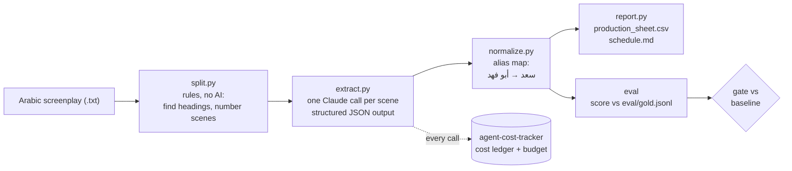

# arabic-script-breakdown

An agent that reads an Arabic TV screenplay and produces a **script breakdown**: for every scene, whether
it is interior or exterior, day or night, where it is shot, which actors are needed, and which props,
vehicles, animals, extras and effects it needs. An assistant director does this by hand before anything
can be scheduled, because the shooting schedule, the daily call sheets and the budget are all built from it:
you group scenes by location to save company moves, you book each actor only on the days their scenes are
shot, and you price props, cars and extras from the list. This repo does the first pass automatically and,
more importantly, comes with an **Arabic evaluation set and a regression gate** so you can tell whether
a new model or prompt is better or worse before you trust it.

> **Data note:** the screenplay in `data/` is **synthetic**, written for this project (a high-school
> drama set in Riyadh: MSA headings and action lines, Saudi/Gulf dialect dialogue). It is not from any
> real production. **Gold labels: drafted, pending native-speaker review.**

## How it works



| File | What it does |
|---|---|
| `breakdown/split.py` | Finds scene headings with plain rules (`مشهد ١`, `م/2`, `م.13`, `مشهد (3)`, `٥ -`, or no number at all) and gives each scene a number. Also counts length in eighths of a page. |
| `breakdown/schema.py` | The Pydantic model of one scene's breakdown. |
| `breakdown/extract.py` | The prompt and the API call. Structured output means the answer is always valid JSON in the schema. The scene text is treated as data, and the previous scene's heading is passed so `متصل` (continuous) scenes get the right time of day. |
| `breakdown/normalize.py` | Arabic normalization (tashkeel, tatweel, alef/ya/ta marbuta forms, Arabic-Indic digits) and the character alias map. |
| `breakdown/report.py` | The CSV (UTF-8 with BOM so Excel shows Arabic) and the per-actor / per-location schedule view. |
| `breakdown/score.py` | Per-field scoring and the regression check. |
| `breakdown/eval.py` | The eval command: run, score, log to `eval/history.csv`, gate. |

**Why an alias map?** In a script one person has several names: the father is `أبو فهد` in dialogue,
`سعد` in an action line, and the model often answers with the cast-list form `سعد العتيبي (أبو فهد)`.
A scheduler needs exactly one row per actor, or the same actor gets booked twice. The prompt asks for
cast-list names; the alias map is the safety net that turns every variant into one canonical name, and each
scene records what it changed (`alias_fixes`). In the sample run, 24 of 26 scenes needed at least one fix.

## Quickstart

```powershell
py -3.13 -m venv .venv
.venv\Scripts\activate
pip install -r requirements.txt        # includes the sibling ../agent-cost-tracker
copy .env.example .env                 # put ANTHROPIC_API_KEY in it (a .env in a parent folder also works)
python -m pytest                       # 37 tests, no API calls
python -m breakdown data/kamera_jaddi.txt --out output
python -m breakdown.eval --model claude-haiku-5-5 --effort low --baseline
```

All API calls go through `tracked_call` from [agent-cost-tracker](../agent-cost-tracker), which records
the cost of each call in a shared SQLite ledger and refuses to call once the budget is used up.
`python -m agent_cost_tracker report` shows the spend.

## Sample output

`examples/production_sheet.csv` (a few rows, Haiku, effort low):

| رقم المشهد | داخلي/خارجي | الوقت | المكان | الشخصيات | الإكسسوار | المؤثرات | متصل |
|---|---|---|---|---|---|---|---|
| 8 | داخلي | ليل | غرفة فهد / بيت الجدة لطيفة في جدة | فهد، الجدة لطيفة | جوال | صوت البحر من بعيد | |
| 9 | داخلي | ليل | غرفة فهد | فهد، سارة | هاتف، كشاف صغير | | نعم |
| 13 | خارجي | فجر | سطح بيت أبو فهد | فهد، أبو فهد | كاميرا قديمة، حامل ثلاثي | صوت أذان الفجر | |
| 25 | داخلي | ليل | مسرح المدرسة | المدير، فهد، ريان، ماجد، أبو فهد، أم فهد، سارة، الأستاذ عادل | ميكروفون | تصفيق عالي | نعم |

Scene 9 says `متصل` instead of a time and the agent correctly carried `ليل` over from scene 8. In scene 13
the father only appears silently at the door, and he is still listed, because he still has to be on set.

`examples/schedule.md` turns this into what a scheduler wants: which scenes each actor is needed for
(فهد: 21 scenes, الجدة لطيفة: only scene 8, so she can be booked for one day) and which scenes share a
location (غرفة فهد: scenes 9, 12, 19, 20, shoot them together).

## The evaluation

### How the set was built

One synthetic 26-scene episode (`data/kamera_jaddi.txt`), written on purpose to contain the cases that
break a naive breakdown, and one gold record per scene in `eval/gold.jsonl`. `eval/REVIEW_FOR_ZIAD.md` is
the review sheet for the native-speaker check (status: drafted, pending review). Hard cases covered:

| Hard case | Scenes |
|---|---|
| Inconsistent headings: `مشهد ١` / `م/2` / `مشهد (3)` / `٥ -` / `م.13` / no number; Arabic-Indic and Western digits | 1, 2, 3, 5, 6, 13, 19 |
| One person, many names: nickname (`فهود`, `ريّون`), title (`المدير` = `الأستاذ خالد الزهراني`), real name (`سعد` = `أبو فهد`) | 2, 4, 5, 18, 21 |
| Character mentioned but not present (talked about, in a photo, on a screen) | 3, 7, 10, 16, 18, 25, 26 |
| Present but silent (must still be booked) | 1, 2, 13, 14, 20, 24 |
| Prop mentioned only in dialogue (not a prop) | 7, 8, 18, 22 |
| Flashback with a younger actor (`فهد الصغير`) | 11 |
| Phone call cut between Riyadh and Jeddah (both actors needed) | 8 |
| `متصل` (continuous) scenes: time comes from the previous scene | 9, 16, 25 |
| Night / dawn / sunset edges: `فجر`, `غروب`, `آخر الليل` (= ليل) | 13, 17, 19, 20 |
| Animals, vehicles and extras that are not cast | 1, 6, 15, 17, 24 |

### Metrics

| Field | How it is scored |
|---|---|
| `int_ext`, `time_of_day` | Exact match (fixed list of values). Accuracy. |
| `location` | Normalized match: same after Arabic normalization, or one contains the other. Accuracy. |
| `characters` | Set precision / recall / F1, after the alias map. |
| `props` | Set precision / recall / F1. Two props match if their main noun (the first word of the Arabic noun phrase) is the same after normalization, with a short synonym list for MSA vs Gulf words (`هاتف` / `جوال`) and spelling variants (`فنجان` / `فنجال`). |
| overall | Plain average of the five field scores. |

Precision answers "of what the agent listed, how much was really there?" Recall answers "of what was really
there, how much did the agent list?" F1 is one number that is only high when both are.

Every run prints a per-scene error list, saves the raw outputs to `eval/runs/`, and appends a row to
`eval/history.csv` with: date, git commit, model, effort, prompt version (a hash of the prompt and schema),
scorer version, per-field scores, and the cost of the run from the cost ledger.

### The regression gate (before launch and after every update)

`eval/baseline.json` holds the scores of the last accepted run. `--baseline` compares a new run with it and
**exits non-zero if any field drops by more than 0.05** (`--threshold`), so it can sit in CI and block a
merge. The routine:

1. **Before launch:** run the eval, read every per-scene error, fix the prompt or the labels, and accept the
   cheapest configuration that is good enough with `--accept`.
2. **After every change** (new prompt, new model, new SDK version, changed normalization): run with
   `--baseline`. Green means ship. Red names the field that dropped and the scenes that broke.
3. **Re-scoring is free:** if the scorer or the gold labels change, `--from-run eval/runs/<run>.jsonl`
   re-scores saved outputs without calling the API, and `tests/test_recorded_run.py` does this in pytest so
   an accidental scorer change is caught too.

### How I would grow it with a real production

- Add real scripts from the team (with permission), a few scenes from each writer, because each writer has a
  different heading style and dialect mix.
- Every correction the assistant director makes to the agent's output in production becomes a new gold row
  (with the scene and the reason). The set grows from real mistakes, not from guesses.
- Two reviewers label a sample independently, to measure how much humans agree on fuzzy fields like props.
- Keep a "hard cases" slice that is reported separately, so a model that gets better on easy scenes cannot
  hide getting worse on flashbacks or phone calls.

## Results

All runs on the same 26 scenes, prompt version `9eb1d255`, scorer v2. Costs come from the cost ledger
(one full script = 26 calls).

| Model | Effort | INT/EXT | Time | Location | Characters F1 | Props F1 (P / R) | Overall | Cost per script |
|---|---|---|---|---|---|---|---|---|
| claude-haiku-5-5 | low (baseline run) | 1.00 | 1.00 | 1.00 | 1.000 | 0.973 (0.96 / 0.98) | 0.995 | $0.016 |
| claude-haiku-5-5 | low (second run, gate check) | 1.00 | 1.00 | 1.00 | 0.993 | 0.957 (0.93 / 0.98) | 0.990 | $0.016 |
| claude-haiku-5-5 | medium | 1.00 | 1.00 | 1.00 | 1.000 | 0.973 (0.98 / 0.96) | 0.995 | $0.018 |
| claude-sonnet-5-5 | default | 1.00 | 1.00 | 1.00 | 1.000 | 0.914 (0.88 / 0.95) | 0.983 | $0.254 |
| Experiment: Haiku low, cast list removed from the prompt | low | 1.00 | 1.00 | 1.00 | 0.986 | 0.965 (0.95 / 0.98) | 0.990 | $0.015 |

**Which to use:** Haiku at effort low. It passes the gate, ties for the best score, and costs about
$0.016 per episode, roughly 16 times less than Sonnet. Sonnet did not do better here: it lists more set
dressing and costume as props (the iron gate, chalk, the principal's glasses, a shemagh), which lowers props
precision. Medium effort on Haiku cost 10% more for the same score. The second Haiku low run shows that
two runs of the same setup differ slightly (0.995 vs 0.990), which is exactly why the gate has a threshold
instead of demanding identical scores.

**What the scores do and don't say:** INT/EXT, time and location are at 1.00 for every model because these
headings state them clearly; on this set those fields only check that nothing breaks. The signal is in
characters and props. The first scoring pass (scorer v1, still in `eval/history.csv`) gave props around
0.79, but reading the errors showed most were **the scorer** being too strict about Arabic wording, not the
model being wrong: `هاتف` vs `جوال`, `فنجان` vs `فنجال`, `كاميرا قديمة` vs `كاميرا سينما قديمة`. I fixed the
scorer (v2), not the prompt, and re-scored the saved runs for free. Removing the cast list from the prompt
(the experiment row) barely moved the score, but only because the alias map fixed 7 names such as
`سعد`, `خالد` and `بندر`; without the alias map that run's character F1 would have been 0.88, a drop the
gate would block.

**Dialect-related errors seen:** in scene 9 one Haiku run listed the grandmother as present because Sara
says `سمعتك تكلم يمه لطيفة` right after the phone call (`يمه` is a Gulf word for grandmother here, and she
is only being talked about). In scene 18, `بكاميرا أبوي` (said in dialogue) was listed as a prop. Both are
the "mentioned, not present" case written in dialect, and both are in the gold set because of that.

**Cost note:** input tokens dominate (about 4,000 per scene, mostly the same instructions, cast list and
schema repeated 26 times). Prompt caching or sending a few scenes per call are the next things to measure.

## Limits

- One synthetic script in one writing style, 26 scenes. This is a test harness for the pipeline and for
  comparing configurations, **not a general accuracy claim** about Arabic screenplays.
- Gold labels are drafted and still need the native-speaker review in `eval/REVIEW_FOR_ZIAD.md`.
- Costume, effects, extras, vehicles and animals are extracted but not scored yet; props and characters
  were the priority because they are what schedules and budgets break on.
- Length in eighths of a page is counted from line numbers, so it is a rough estimate.
- The prompt and the gold labels follow the same written rules (what counts as a prop, who counts as
  present). A production team with different rules would need to change both.
