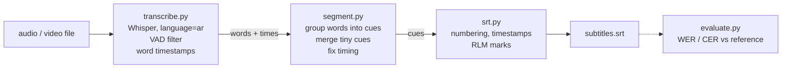

# gulf-whisper-srt

Turn Arabic speech, including Saudi/Gulf dialect, from an audio or video file into a clean
Arabic `.srt` subtitle file, on your own machine with no paid API. It runs Whisper
(`large-v3-turbo` through [faster-whisper](https://github.com/SYSTRAN/faster-whisper)) to get
every word with its timing, then cuts the words into subtitles that follow broadcast-style rules
(two lines of at most 42 characters, 1 to 6 seconds on screen, readable speed, no overlaps), and
writes them with the invisible right-to-left marks Arabic lines need to display correctly.
It also includes a small WER/CER evaluation, so accuracy claims come with numbers and say
what they were measured on.

## Why this is useful for a drama production house

- **Subtitle drafts for editors.** An editor gets a timed first draft to correct in their usual
  tool (Premiere, DaVinci Resolve, Subtitle Edit) instead of typing every line from zero.
  Correcting a draft is much faster than writing one.
- **Searchable dialogue for the archive.** Every episode, rush or interview becomes text with
  timecodes, so "find the scene where he says «الديرة»" is a text search.
- **Private and cheap.** Unreleased footage never leaves the machine, and there's no per-minute cost.

## Quickstart

```bash
git clone <this repo> && cd gulf-whisper-srt
python -m venv .venv && .venv\Scripts\activate          # Linux/macOS: source .venv/bin/activate
pip install -e ".[dev]"
pip install -e ".[cuda]"     # optional, NVIDIA GPU: CUDA 12 cuBLAS + cuDNN 9 as pip packages

python -m gulf_srt episode01.mp4 -o episode01.srt --model large-v3-turbo
```

The first run downloads the model (~1.6 GB for `large-v3-turbo`). Video files work directly:
the audio track is decoded with PyAV, so ffmpeg doesn't need to be installed.

Options: `--device auto|cuda|cpu` (auto tries the GPU and falls back to CPU int8),
`--max-line-chars 42`, `--no-rtl-marks`.

Evaluate and test:

```bash
pytest                                            # 30 unit tests, no model download
python scripts/fetch_samples.py                   # downloads the licensed clips (data/sources.md)
python scripts/run_eval.py --model large-v3-turbo # SRTs + WER/CER table in results/
python -m gulf_srt.evaluate reference.txt hypothesis.srt
```

## Pipeline



| File | What it does |
|---|---|
| `gulf_srt/transcribe.py` | Loads the model (GPU float16, or CPU int8) and returns every word with its start/end time. Forces `language="ar"`, turns on the VAD filter (skips music and silence, where Whisper tends to invent text), and turns off "condition on previous text" so one mistake doesn't repeat down the file. |
| `gulf_srt/segment.py` | The subtitle rules (below). Pure Python, fully unit-tested. |
| `gulf_srt/srt.py` | Writes the SRT file and adds U+200F marks to Arabic lines. |
| `gulf_srt/cli.py` | The `python -m gulf_srt` command. |
| `gulf_srt/evaluate.py` | Arabic normalization, WER and CER. |
| `scripts/fetch_samples.py` | Downloads the evaluation clips from their original sources. |
| `scripts/run_eval.py` | Runs the pipeline on every clip and writes the results table. |

## Subtitle rules, and why

| Rule | Default | Why |
|---|---|---|
| Max characters per line | 42 | Common broadcast/streaming limit (Netflix uses 42 for Arabic); longer lines are hard to read in one glance. |
| Max lines per cue | 2 | A third line covers the picture. |
| Line break | after punctuation if it fits, otherwise the most balanced split | Two even lines are easier to read than one long and one short. |
| Duration | 1.0 s to 6.0 s | Under a second is a flash nobody can read; over six seconds people re-read the line. |
| Reading speed | ≤ 17 characters per second | Adult reading-speed guideline. If a cue is too fast, its end time is stretched into the silence after it. |
| Where to cut | end of sentence, a pause ≥ 0.6 s, or a comma once the cue is a full line | Subtitles should follow the speaker's phrasing. When a hard limit (length or 6 s) forces a cut, the code looks back for the last comma or pause instead of cutting mid-phrase. |
| Tiny cues | under 8 characters or under 1 s get merged into a neighbour, if they are less than 1 s apart and the result still fits | One-word cues like «ايه.» flicker on screen. |
| Overlaps | never | Each cue ends at or before the next one starts. |

**Right-to-left marks.** Players guess each line's direction from its first "strong" letter, and
punctuation at the edges takes the direction of its neighbours, so every Arabic line is wrapped in
invisible U+200F (RIGHT-TO-LEFT MARK) characters to keep lines like «Netflix عرضت المسلسل؟» laid
out right-to-left. The words themselves are not reordered or changed, and the tests check both things.

## Sample output

From `results/large-v3-turbo-cuda/sada_demo_scene.srt` (Saudi dialect TV comedy, SADA, CC BY-NC-SA 4.0).
The Whisper mistakes are left in on purpose. This is what an editor would get as a first draft:

```srt
7
00:00:25,760 --> 00:00:31,240
‏تدري ليش، تعرف اللعب الأجنبي خليت؟‏

8
00:00:32,760 --> 00:00:38,660
‏خليت، كذا عبود،‏
‏تراك صدقت نفسك ومسوي عمرك أجنبي‏

9
00:00:38,660 --> 00:00:41,680
‏يا ابن الحلال انت بالنفسك لا تتمصع،‏

10
00:00:41,680 --> 00:00:45,040
‏تراك كلك عذب ما فيك ولا لحم حلوة،‏
```

## Results

Model `large-v3-turbo`, faster-whisper 1.2.1, beam size 5, VAD on. GPU: RTX 5060 Laptop (8 GB), float16.
RTF (real-time factor) = processing time ÷ audio length, so 0.03 means one minute of audio takes about 2 seconds.
The model load and a one-second warm-up are not counted. WER/CER columns are from the GPU run.
The CPU run (int8, same model) produces slightly different text; its full table is in
`results/large-v3-turbo-cpu/results.md` (pooled WER 14.2% MSA, 41.6% dialect).

| Clip | Variety | Length (s) | WER light norm. | WER Arabic norm. | CER Arabic norm. | RTF (GPU) | RTF (CPU int8) |
|---|---|---|---|---|---|---|---|
| fleurs_ar_007 | MSA, read | 23.8 | 8.3% | 5.6% | 0.9% | 0.056 | 0.409 |
| fleurs_ar_066 | MSA, read | 25.7 | 6.9% | 6.9% | 2.6% | 0.025 | 0.372 |
| fleurs_ar_184 | MSA, read | 23.8 | 45.8% | 45.8% | 10.2% | 0.024 | 0.511 |
| fleurs_ar_263 | MSA, read | 21.5 | 8.3% | 0.0% | 0.0% | 0.028 | 0.687 |
| sada_scene_a | Saudi dialect, TV comedy | 48.9 | 45.7% | 36.2% | 13.8% | 0.037 | 0.583 |
| sada_scene_b | Saudi dialect, TV comedy | 60.9 | 52.1% | 47.9% | 21.6% | 0.038 | 0.655 |
| sada_demo_scene | Saudi dialect, TV comedy | 55.0 | no reference | no reference | no reference | 0.040 | 0.774 |

Pooled (all errors ÷ all reference words), Arabic normalization:

| Variety | Reference words | WER | CER |
|---|---|---|---|
| MSA, read (4 clips) | 113 | 13.3% | 3.2% |
| Saudi dialect, TV comedy (2 clips) | 190 | 42.1% | 17.8% |

**How to read this.**
- **"Light" normalization** only removes punctuation. **"Arabic" normalization** also removes
  diacritics and tatweel and treats أ/إ/آ/ا, ة/ه and ى/ي as the same letter. The same transcript
  scores 8.3% or 0.0% WER on `fleurs_ar_263` depending only on that choice, which is why any WER
  number should say how the text was normalized.
- **CER is much lower than WER** in Arabic because one wrong letter in a word with attached
  particles («والأسماك» vs «في الأسماك») makes the whole word wrong.
- **`fleurs_ar_184` is the bad MSA clip.** It is full of rare words: «الموزاصور» (mosasaur) became
  «الموز الصور», «السلاحف» became «السلاح في», and «اللحوم» became «الرحوم».
- **The dialect gap is real but partly inflated.** Whisper often writes dialect in MSA spelling
  («علشان» → «على شأن») or spells a word differently from the reference («تاني» vs «ثاني»), and the SADA reference writes laughter as words («هاها»),
  which Whisper never outputs. A human would accept some of these, but WER doesn't.
  The draft is still useful to correct, but dialect needs a human pass.

**Limits.** Measured on 6 short clips (about 3.4 minutes with references) from 2 sources. This is
not a general accuracy claim. The dialect numbers come from one episode of one Saudi show, so they
say nothing about other Gulf dialects, noisy sets, or overlapping speech. `data/needs_reference.md`
lists clips a native speaker could transcribe to widen the test.

## Hardware notes

Tested on Windows 11, NVIDIA GeForce RTX 5060 Laptop GPU (8 GB, Blackwell, compute capability 12.0,
driver 616.92), Python 3.13.7.

- **faster-whisper on the GPU works.** CTranslate2 4.8.2 (the inference engine under faster-whisper)
  saw the GPU and ran `large-v3-turbo` in float16 on the first try, with CUDA 12 libraries installed
  from pip (`nvidia-cublas-cu12` 12.9, `nvidia-cudnn-cu12` 9.27). There was no need to fall back to
  PyTorch or to the CPU.
- **Windows DLL path.** Those pip packages put their DLLs in `site-packages/nvidia/*/bin`, which
  Windows doesn't search, so `transcribe.py` adds those folders before loading the model.
- **PyAV 16+ breaks faster-whisper 1.2.1** (`open() got an unexpected keyword argument 'metadata_errors'`).
  PyAV is pinned below 16 (15.1.0 was used).
- **CPU fallback** (`--device cpu`, int8) also works with the same model, at an RTF of about 0.4-0.8
  (a 45-minute episode in roughly 20-35 minutes) instead of about 0.03 on the GPU.
- **No ffmpeg needed.** Audio and video are decoded with PyAV, which bundles its own ffmpeg libraries.
- **Hallucination check.** Fed 20 s of pure noise without the VAD filter, Whisper produced
  «اشتركوا في القناة» ("subscribe to the channel"), a well-known Whisper failure picked up
  from YouTube training data. That's why the VAD filter is on by default.

## License

Code: MIT. Evaluation clips and the transcripts in `results/` keep their own licenses;
see `data/sources.md`.
