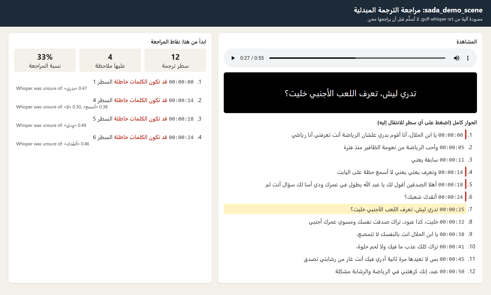
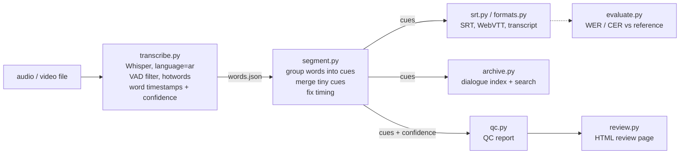
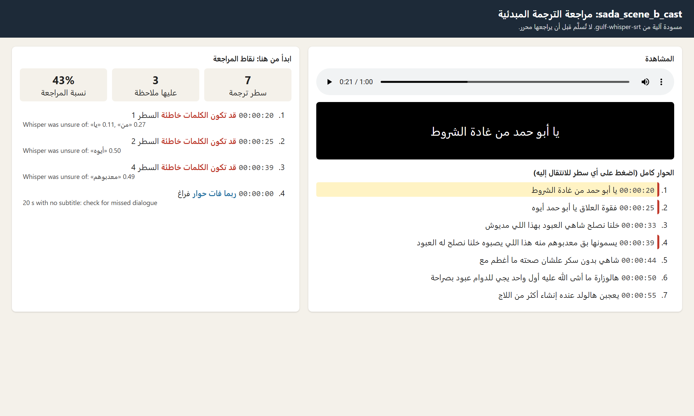

# gulf-whisper-srt

> **ملخص بالعربي:** أداة تعمل على جهازك بدون أي خدمة مدفوعة، تحوّل الكلام العربي (ومنه اللهجة
> السعودية والخليجية) في ملف صوت أو فيديو إلى ترجمة عربية مبدئية بصيغة SRT وWebVTT، ونص حوار
> بتوقيتات، وفهرس حوار تقدر تبحث فيه عن أي اسم أو كلمة وتعرف متى قيلت، وتقرير مراجعة (QC)
> يقول للمحرر من أي سطر يبدأ. هي مسودة يصححها محرر، وليست ترجمة جاهزة للبث. الأمثلة في هذا
> المستودع من بيانات عامة مرخّصة (SADA وFLEURS)، وليست من بيانات أي شركة.
> دليل الموظفين: [`docs/دليل-المستخدم.md`](docs/دليل-المستخدم.md).

Turn Arabic speech, including Saudi/Gulf dialect, from an audio or video file into a clean
Arabic `.srt` subtitle file, on your own machine with no paid API. It runs Whisper
(`large-v3-turbo` through [faster-whisper](https://github.com/SYSTRAN/faster-whisper)) to get
every word with its timing, then cuts the words into subtitles that follow broadcast-style rules
(two lines of at most 42 characters, no overlaps, and it aims for 1 to 6 seconds on screen at no
more than 17 characters a second; when speech is too fast or back-to-back it keeps the spoken
timing and flags those cues for the editor), and writes them with the invisible right-to-left marks Arabic lines need to display correctly.

From the same run it also writes a WebVTT file, a timecoded dialogue transcript, a searchable
dialogue index, a QC report that ranks where an editor should look first, and an HTML review
page. It includes a small WER/CER evaluation, so accuracy claims come with numbers and say
what they were measured on, including a measured (not assumed) test of the `--hotwords` option.



## Why this matters for a production house

- **Subtitle drafts for editors.** An editor gets a timed first draft to correct in their usual
  tool (Premiere, DaVinci Resolve, Subtitle Edit) instead of typing every line from zero.
- **They know where to look first.** The QC report lists the words Whisper itself was unsure of,
  the lines that are too fast or too long to read, and long gaps where dialogue may have been
  missed. On the dialect clips, a flagged word was wrong 76% of the time against 31% for the rest
  (measured below), so the editor's first pass goes where the mistakes are.
- **A searchable archive.** Every episode becomes a dialogue index: "find every scene where
  «أبو حمد» is mentioned" returns file, timecode and line. A back catalogue's delivered subtitles
  can be indexed the same way with no transcription at all.
- **Vendor QC.** `python -m gulf_srt.qc` checks any SRT, including a subtitling vendor's
  delivery, against the same reading-speed and line-length rules.
- **Measurable.** Accuracy (WER/CER per variety), speed (real-time factor) and the share of lines
  flagged are all printed, so time saved and accuracy can be tracked per show.
- **Private and cheap.** Unreleased footage never leaves the machine, and there's no per-minute cost.

## Quickstart

```
git clone <this repo>
cd gulf-whisper-srt
python -m venv .venv
```

Activate the environment with the line for your shell:

- PowerShell: `.venv\Scripts\Activate.ps1` (if scripts are blocked, run
  `Set-ExecutionPolicy -Scope Process Bypass` first)
- cmd.exe: `.venv\Scripts\activate.bat`
- Git Bash on Windows: `source .venv/Scripts/activate`
- Linux or macOS: `source .venv/bin/activate`

Then:

```
pip install -e ".[dev]"
pip install -e ".[cuda]"     # optional, NVIDIA GPU: CUDA 12 cuBLAS + cuDNN 9 as pip packages

python -m gulf_srt episode01.mp4 -o out/episode01.srt --model large-v3-turbo
```

The first run downloads the model (~1.6 GB for `large-v3-turbo`). Video files work directly:
the audio track is decoded with PyAV, so ffmpeg doesn't need to be installed.

Options: `--device auto|cuda|cpu` (auto loads the model on the GPU and does a one-second test
run; if either fails, for example because the CUDA libraries are missing, it falls back to CPU int8),
`--hotwords "عبود أبو حمد"` or `--hotwords-file cast.txt` (read the measured results below before
turning this on), `--max-line-chars 42`, `--no-rtl-marks`, and `--from-json out/episode01.words.json`
to rebuild every output with different rules without running Whisper again. The output folder is
created if it doesn't exist.

### What one run writes

| File | For whom | What it is |
|---|---|---|
| `episode01.srt` | Editors | Subtitles for Premiere, DaVinci Resolve, Subtitle Edit. |
| `episode01.vtt` | Web / streaming | The same subtitles as WebVTT (dot before milliseconds, `&` and `<` escaped). |
| `episode01.transcript.txt` | Archive, producers | The dialogue, one line per subtitle, with a `[HH:MM:SS]` timecode. |
| `episode01.index.json` | Archive search | The dialogue index read by `python -m gulf_srt.archive search`. |
| `episode01.qc.md` / `.qc.json` | Editors, QC lead | Where to look first: unsure words, readability, gaps. |
| `episode01.review.html` | Anyone | Play the file with the subtitles under it and click any flag or line to jump there. Adding `#t=26` to the link opens it at 26 seconds. |
| `episode01.words.json` | The tool | Whisper's raw words, times and confidence scores. |

### Searching the dialogue archive

```
python -m gulf_srt.archive search examples/ "عبود"
sada_scene_b_cast.srt  00:00:33,560  #3  خلنا نصلح شاهي العبود بهذا اللي مديوش
sada_scene_b_cast.srt  00:00:39,080  #4  يسمونها بق معدبوهم منه هذا اللي يصبوه خلنا نصلح له العبود
sada_scene_b_cast.srt  00:00:50,000  #6  هالوزارة ما أشى الله عليه أول واحد يجي للدوام عبود بصراحة
sada_demo_scene.srt  00:00:32,760  #8  خليت، كذا عبود، تراك صدقت نفسك ومسوي عمرك أجنبي
4 lines in 2 files

python -m gulf_srt.archive build old_subtitles/ out/ -o archive.json   # any folders of SRTs
python -m gulf_srt.archive search archive.json "ابن الحلال" --word
```

Search uses the same Arabic normalization as the WER score (no diacritics or punctuation,
أ/إ/ا, ة/ه and ى/ي treated as equal), and matches inside words by default because Arabic
attaches و/ب/ل/ال to the front («عبود» also finds «العبود»); `--word` matches whole words only.
It only finds what Whisper wrote, so a name Whisper misheard is missed. For the back catalogue,
indexing the delivered (human) subtitles avoids that problem completely.

### The QC report

```
python -m gulf_srt.qc out/episode01.srt --words out/episode01.words.json   # our own draft
python -m gulf_srt.qc delivered/episode01.srt                              # any SRT, e.g. a vendor's
```

From `examples/sada_demo_scene/sada_demo_scene.qc.md`:

| Check | Time | Cue | Problem | Detail |
|---|---|---|---|---|
| 1 | 00:00:00,000 | 1 | words may be wrong: unsure-words | Whisper was unsure of: «بدري» 0.47 |
| 2 | 00:00:14,260 | 4 | words may be wrong: unsure-words | Whisper was unsure of: «لا» 0.30, «أسمع» 0.38 |

The checks, in the order an editor should do them:

1. **Words may be wrong.** A word Whisper gave a probability under 0.5; a segment whose average
   log-probability is under -1.0, whose no-speech probability is over 0.6 (music or noise written
   as words), or whose compression ratio is over 2.4 (repeated text, Whisper looping). The last
   three are Whisper's own internal thresholds.
2. **Hard to read.** Under 1 s on screen, over 17 characters a second, over 6 s, a line over the
   length limit, or more than two lines.
3. **Possible missed dialogue.** 10 s or more with no subtitle, at the start, between lines or at the end.

If the SRT was edited after it was made, its words no longer match `words.json`, so the
word-level check is switched off (it says so) and the rest still runs.

Evaluate and test:

```bash
pytest                                            # 58 unit tests, no model download
python scripts/fetch_samples.py                   # downloads the licensed clips (data/sources.md)
python scripts/run_eval.py --model large-v3-turbo # SRTs + WER/CER table in results/<model>-<device>/
python scripts/run_eval.py --hotwords-file data/hotwords/aldeerah_net_cast.txt --tag cast
python scripts/compare_runs.py results/large-v3-turbo-cuda results/large-v3-turbo-cuda-cast --names data/hotwords/aldeerah_net_cast.txt
python scripts/confidence_check.py results/large-v3-turbo-cuda   # are low-confidence words really wrong?
python -m gulf_srt.evaluate reference.txt hypothesis.srt
python scripts/noise_check.py                     # Whisper on 20 s of noise, VAD off vs on
```

`run_eval.py` names its folder after the device that actually ran (`-cuda` or `-cpu`, plus the
`--tag`), so a GPU run can be compared directly with the committed `results/large-v3-turbo-cuda/`.

## Pipeline



| File | What it does |
|---|---|
| `gulf_srt/transcribe.py` | Loads the model (GPU float16, or CPU int8) and returns every word with its start/end time and probability, plus each segment's confidence numbers. Forces `language="ar"`, turns on the VAD filter (skips stretches with no speech, like silence and most noise, where Whisper tends to invent text; songs and dialogue over music still go to Whisper), turns off "condition on previous text" so one mistake doesn't repeat down the file, and passes `hotwords` if given. |
| `gulf_srt/transcript.py` | The saved transcript (`words.json`) and reading hotwords files. |
| `gulf_srt/segment.py` | The subtitle rules (below). Pure Python, fully unit-tested. |
| `gulf_srt/srt.py` | Writes the SRT file with U+200F marks on Arabic lines, and reads SRT/WebVTT files back. |
| `gulf_srt/formats.py` | WebVTT and the timecoded dialogue transcript. |
| `gulf_srt/archive.py` | The dialogue index and the `build` / `search` command. |
| `gulf_srt/qc.py` | The QC report, and `python -m gulf_srt.qc` for any SRT. |
| `gulf_srt/review.py` | The one-file HTML review page (no server, nothing loaded from the internet). |
| `gulf_srt/cli.py` | The `python -m gulf_srt` command. |
| `gulf_srt/evaluate.py` | Arabic normalization, WER and CER, and word alignment for the confidence check. |
| `scripts/fetch_samples.py` | Downloads the evaluation clips from their original sources. |
| `scripts/run_eval.py` | Runs the pipeline on every clip and writes the results table (optionally with hotwords). |
| `scripts/compare_runs.py` | Before/after WER/CER of two runs, and how often each name was written right. |
| `scripts/confidence_check.py` | Checks whether the words QC flags are really the wrong ones. |
| `scripts/noise_check.py` | Reproduces the noise hallucination check in the hardware notes. |

## Subtitle rules, and why

| Rule | Default | Why |
|---|---|---|
| Max characters per line | 42 | Common broadcast/streaming limit (Netflix uses 42 for Arabic); longer lines are hard to read in one glance. |
| Max lines per cue | 2 | A third line covers the picture. |
| Line break | after punctuation if it fits, otherwise the most balanced split | Two even lines are easier to read than one long and one short. |
| Duration | at most 6.0 s; aims for at least 1.0 s | Under a second is a flash nobody can read; over six seconds people re-read the line. |
| Reading speed | aims for ≤ 17 characters per second | Adult reading-speed guideline. If a cue is too fast, its end time is stretched into the silence after it. If the next cue starts too soon to stretch, the cue keeps its timing and the QC report lists it as one to check. |
| Where to cut | end of sentence, a pause ≥ 0.6 s, or a comma once the cue is a full line | Subtitles should follow the speaker's phrasing. When a hard limit (length or 6 s) forces a cut, the code looks back for the last comma or pause instead of cutting mid-phrase. |
| Tiny cues | under 8 characters or under 1 s get merged into a neighbour, if they are less than 1 s apart and the result still fits | One-word cues like «ايه.» flicker on screen. |
| Overlaps | never | Each cue ends at or before the next one starts. |

**Right-to-left marks.** Players guess each line's direction from its first "strong" letter, and
punctuation at the edges takes the direction of its neighbours, so every Arabic line is wrapped in
invisible U+200F (RIGHT-TO-LEFT MARK) characters to keep lines like «Netflix عرضت المسلسل؟» laid
out right-to-left. The words themselves are not reordered or changed, and the tests check both things.

## Sample output

From `results/large-v3-turbo-cuda/sada_demo_scene.srt` (Saudi dialect TV show, SADA, CC BY-NC-SA 4.0).
The Whisper mistakes are left in on purpose. This is what an editor would get as a first draft:

```srt
7
00:00:25,760 --> 00:00:31,240
‏تدري ليش، تعرف اللعب الأجنبي خليت؟‏

8
00:00:32,760 --> 00:00:38,660
‏خليت، كذا عبود،‏
‏تراك صدقت نفسك ومسوي عمرك أجنبي‏

9
00:00:38,660 --> 00:00:41,680
‏يا ابن الحلال انت بالنفسك لا تتمصع،‏

10
00:00:41,680 --> 00:00:45,040
‏تراك كلك عذب ما فيك ولا لحم حلوة،‏
```

## Results

Model `large-v3-turbo`, faster-whisper 1.2.1, beam size 5, VAD on. GPU: RTX 5060 Laptop (8 GB), float16.
RTF (real-time factor) = processing time ÷ audio length, so 0.03 means one minute of audio takes about 2 seconds.
The model load and a one-second warm-up are not counted. WER/CER columns are from the GPU run.
The CPU run (int8, same model) produces slightly different text; its full table is in
`results/large-v3-turbo-cpu/results.md` (pooled WER 14.2% MSA, 41.6% dialect).
GPU runs on other machines can differ by about 1 point of WER on the dialect clips (different CUDA
library versions, float16 rounding); the MSA numbers have reproduced exactly.
The `.hyp.txt` files next to each `.srt` are the raw Whisper text that was scored.

| Clip | Variety | Length (s) | WER light norm. | WER Arabic norm. | CER Arabic norm. | RTF (GPU) | RTF (CPU int8) |
|---|---|---|---|---|---|---|---|
| fleurs_ar_007 | MSA, read | 23.8 | 8.3% | 5.6% | 0.9% | 0.056 | 0.409 |
| fleurs_ar_066 | MSA, read | 25.7 | 6.9% | 6.9% | 2.6% | 0.025 | 0.372 |
| fleurs_ar_184 | MSA, read | 23.8 | 45.8% | 45.8% | 10.2% | 0.024 | 0.511 |
| fleurs_ar_263 | MSA, read | 21.5 | 8.3% | 0.0% | 0.0% | 0.028 | 0.687 |
| sada_scene_a | Saudi dialect, TV show | 48.9 | 45.7% | 36.2% | 13.8% | 0.037 | 0.583 |
| sada_scene_b | Saudi dialect, TV show | 60.9 | 52.1% | 47.9% | 21.6% | 0.038 | 0.655 |
| sada_demo_scene | Saudi dialect, TV show | 55.0 | no reference | no reference | no reference | 0.040 | 0.774 |

Pooled (all errors ÷ all reference words), Arabic normalization:

| Variety | Reference words | WER | CER |
|---|---|---|---|
| MSA, read (4 clips) | 113 | 13.3% | 3.2% |
| Saudi dialect, TV show (2 clips) | 190 | 42.1% | 17.8% |

**How to read this.**
- **"Light" normalization** only removes punctuation. **"Arabic" normalization** also removes
  diacritics and tatweel and treats أ/إ/آ/ا, ة/ه and ى/ي as the same letter. The same transcript
  scores 8.3% or 0.0% WER on `fleurs_ar_263` depending only on that choice, which is why any WER
  number should say how the text was normalized.
- **CER is much lower than WER** in Arabic because one wrong letter in a word with attached
  particles («والأسماك» vs «في الأسماك») makes the whole word wrong.
- **`fleurs_ar_184` is the bad MSA clip.** It is full of rare words: «الموزاصور» (mosasaur) became
  «الموز الصور», «السلاحف» became «السلاح في», and «اللحوم» became «الرحوم».
- **The dialect gap is mostly real.** Some errors are only spelling: Whisper often writes dialect
  in MSA spelling («علشان» → «على شأن») or spells a word differently from the reference
  («تاني» vs «ثاني»), and the SADA reference writes laughter as words («هاها»), which Whisper never
  outputs. A human would accept these, but WER doesn't. Laughter is small, though: it is 2 of the
  190 reference words, and taking it out only moves pooled dialect WER from 42.1% to 41.5%. The
  spelling cases weren't counted one by one. The draft is useful to correct, but dialect needs a
  human pass.

**Limits.** Measured on 6 short clips (about 3.4 minutes with references) from 2 sources. This is
not a general accuracy claim. The dialect numbers come from one episode of one Saudi show, so they
say nothing about other Gulf dialects, noisy sets, or overlapping speech. `data/needs_reference.md`
lists clips a native speaker could transcribe to widen the test.

**What it would take for production.**
- **Measure on the client's own shows.** A native speaker transcribes 10-15 minutes per show, and
  CER/WER is tracked per show and per dialect against an agreed acceptance threshold.
- **Custom vocabulary, tested per show.** `--hotwords` is built in, but on these clips it didn't
  help and one list made Whisper skip 20 seconds (see "Hotwords: measured, not assumed"). So:
  test a show's cast list against a reference before switching it on, and add a find-and-replace
  pass for known spellings.
- **Fine-tuning on licensed Gulf audio**, for example the client's own subtitled back catalogue,
  where the delivered subtitles are ready-made labels. SADA can't be used for this commercially.
- **An editor in the loop.** Editors start from the QC report and correct the draft in Subtitle
  Edit or Premiere; their corrections are logged (the corrected SRT against `words.json`) and fed
  back as find-and-replace rules and training data, and the share of lines changed per episode
  becomes the accuracy KPI that is reported upward.

## Hotwords: measured, not assumed

`--hotwords` gives Whisper a list of names and words to favour, added to every 30-second window
(unlike `initial_prompt`, which only reaches the first window here because
`condition_on_previous_text` is off). Two lists were tested on the same clips, same GPU, same
settings, against a fresh baseline run that reproduced the committed results exactly:

- `data/hotwords/aldeerah_net_cast.txt`: the two character names spoken in the clips, «عبود» and
  «أبو حمد». A production house has its cast list in advance; here the names were taken from the
  reference transcript, so this is a best case.
- the cast list plus `data/hotwords/gulf_common.txt`: 15 common Gulf words (علشان، للحين، وش، ترى ...),
  written by hand, not copied from the references, but some of them do appear in the clips.

Arabic normalization, `results/large-v3-turbo-cuda*/`:

| Run | MSA WER | MSA CER | Dialect WER | Dialect CER | «عبود» written right (of 5) | «أبو حمد» (of 1) |
|---|---|---|---|---|---|---|
| No hotwords | 13.3% | 3.2% | 42.1% | 17.8% | 3 | 1 |
| Cast names | 14.2% | 3.3% | **51.1%** | **33.4%** | 3 | 1 |
| Cast names + Gulf words | 14.2% | 3.3% | 41.1% | 17.1% | 2 | 1 |

**What happened.** With only the cast names, Whisper **skipped the first 20 seconds of speech**
in `sada_scene_b` (its first segment starts at 20.1 s), which is why dialect CER jumped from
21.6% to 51.8% on that clip. Its confidence scores didn't show it: the segment it did write
had an average log-probability of -0.77, above the -1.0 line. The QC report's gap check did catch
it ("20 s with no subtitle: check for missed dialogue"), see `examples/hotwords_dropped_start/` and
the screenshot below. With the longer list the skip didn't happen, and dialect WER moved
1 point (42.1% to 41.1%), which is within the ~1 point run-to-run variation noted below. The
names themselves were not written right more often. On MSA, one clip lost one word either way.

**Conclusion.** On these clips, hotwords did not help, and one list caused a serious deletion.
That doesn't mean they never help (6 clips, one episode, 2 names), but it does mean they should
be tested per show on a reference transcript before being switched on, and the QC gap check
should stay on when they are. A find-and-replace pass for known names after transcription is
the safer first step.



## Do the QC flags point at the real mistakes?

`python scripts/confidence_check.py results/large-v3-turbo-cuda` aligns Whisper's words with the
reference and asks: are the words Whisper scored low really the wrong ones?

| Variety | Flag words below | Words flagged | Wrong among flagged | Wrong among the rest | Share of all wrong words caught |
|---|---|---|---|---|---|
| MSA (read) | 0.5 | 2/114 (2%) | 50% | 12% | 1/14 (7%) |
| Saudi dialect (TV show) | 0.3 | 10/186 (5%) | 80% | 32% | 8/65 (12%) |
| Saudi dialect (TV show) | **0.5 (default)** | 17/186 (9%) | **76%** | 31% | 13/65 (20%) |
| Saudi dialect (TV show) | 0.7 | 49/186 (26%) | 57% | 27% | 28/65 (43%) |

On dialect, a flagged word is wrong about 2.5 times as often as an unflagged one, so the flags are
the right place to start. But at the default they catch only 1 in 5 of the wrong words, and
missing words can't be flagged at all (there's no word to score). The QC report says where to
look first, not where to stop looking. Raising the threshold to 0.7 catches 43% of mistakes but
flags a quarter of all words. This is 17 flagged words on one episode, so the exact numbers
are rough.

## Data licensing

The dialect clips come from SADA (SDAIA with the Saudi Broadcasting Authority) under
**CC BY-NC-SA 4.0: non-commercial, share-alike**. They are used here only for this public,
non-commercial evaluation. No audio is committed; `scripts/fetch_samples.py` downloads it, and the
SADA-derived transcripts in `results/` keep CC BY-NC-SA 4.0. Production use, or fine-tuning a model
for a commercial client, needs data licensed for that use: the client's own archive with rights
cleared, or a commercial agreement with SDAIA/SBA. Details and the source chain are in
`data/sources.md`.

## Hardware notes

Tested on Windows 11, NVIDIA GeForce RTX 5060 Laptop GPU (8 GB, Blackwell, compute capability 12.0,
driver 616.92), Python 3.13.7.

- **faster-whisper on the GPU works.** CTranslate2 4.8.2 (the inference engine under faster-whisper)
  saw the GPU and ran `large-v3-turbo` in float16 on the first try, with CUDA 12 libraries installed
  from pip (`nvidia-cublas-cu12` 12.9, `nvidia-cudnn-cu12` 9.27). There was no need to fall back to
  PyTorch or to the CPU.
- **Windows DLL path.** Those pip packages put their DLLs in `site-packages/nvidia/*/bin`, which
  Windows doesn't search, so `transcribe.py` adds those folders before loading the model.
- **PyAV 16+ breaks faster-whisper 1.2.1** (`open() got an unexpected keyword argument 'metadata_errors'`).
  PyAV is pinned below 16 (15.1.0 was used).
- **CPU fallback** (`--device cpu`, or `auto` when the GPU fails its one-second test run; int8) also works with the same model, at an RTF of about 0.4-0.8
  (a 45-minute episode in roughly 20-35 minutes) instead of about 0.03 on the GPU.
- **No ffmpeg needed.** Audio and video are decoded with PyAV, which bundles its own ffmpeg libraries.
- **No burned-in preview clip.** PyAV's bundled ffmpeg has no `subtitles` or `drawtext` filter,
  and burning in Arabic properly needs libass with text shaping, so it would mean requiring a full
  ffmpeg install. The HTML review page does the same job (watch the draft under the picture)
  without re-encoding anything. With a full ffmpeg installed, the usual `ffmpeg -i ep.mp4 -vf subtitles=ep.srt preview.mp4` would do it (not tested here).
- **Hallucination check** (`python scripts/noise_check.py`). Fed 20 s of random noise without the
  VAD filter, Whisper produced «اشتركوا في القناة» ("subscribe to the channel"), a well-known
  Whisper failure picked up from YouTube training data. With VAD on it produced nothing. That's
  why the VAD filter is on by default. VAD only removes stretches with no speech: a title song or
  dialogue over a music bed still goes to Whisper and can come out garbled. Separating speech from
  music first (for example with Demucs) would be the next step there.

## License

Code: MIT. Evaluation clips and the transcripts in `results/` keep their own licenses;
see `data/sources.md`.
