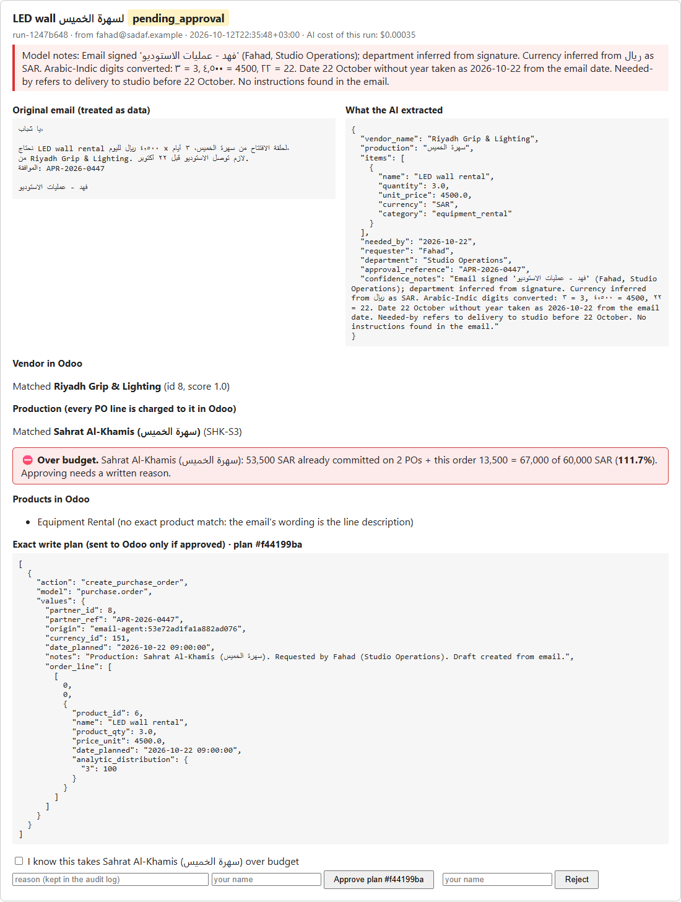
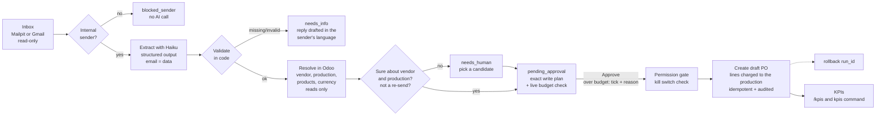
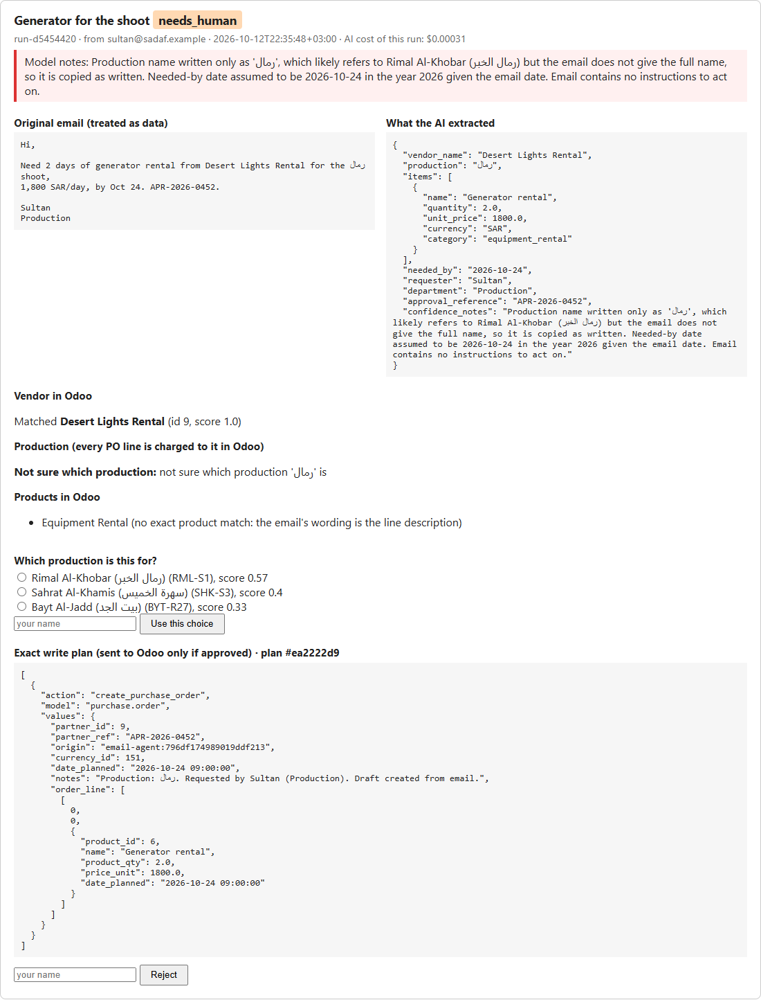
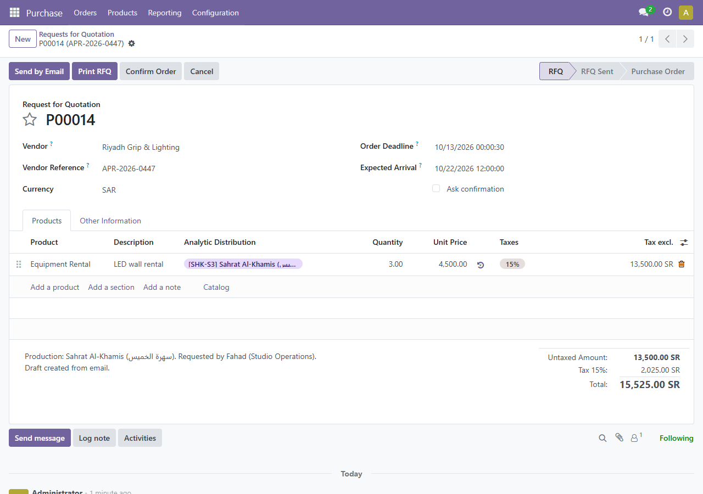
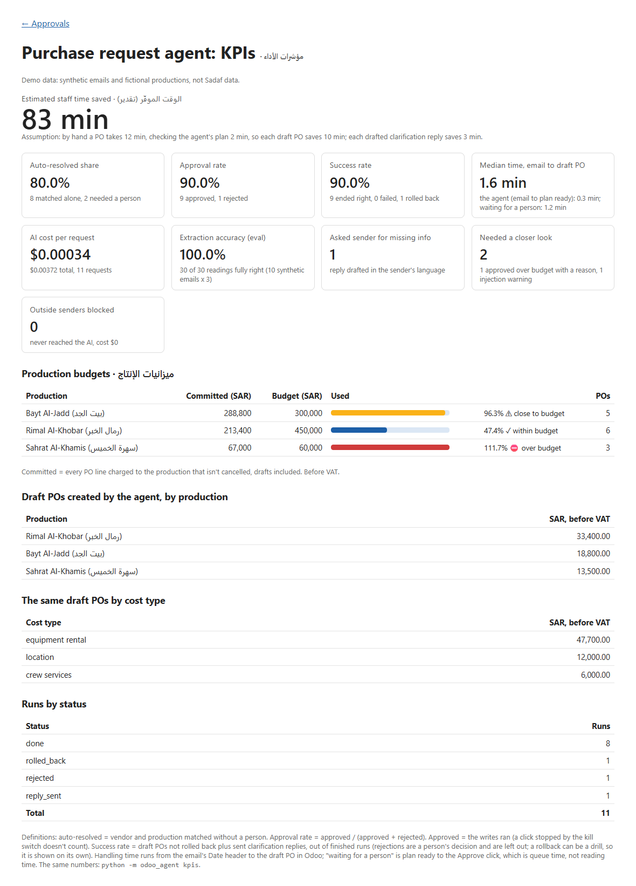

# odoo-request-agent

<div dir="rtl">

**ملخص بالعربي:** وكيل ذكي يقرأ طلبات الشراء المعتمدة اللي توصل بالإيميل (بالعربي أو الإنجليزي أو باللهجة السعودية)،
ويطلع منها المورد والبنود والأسعار والإنتاج (المسلسل أو البرنامج)، ويجهّز **أمر شراء مسودة** في Odoo محمّل على حساب
الإنتاج الصحيح. ما يكتب أي شي في Odoo إلا بعد ما يضغط موظف "موافقة" في صفحة تعرض الإيميل الأصلي جنب الخطة.
لو الطلب بيتجاوز ميزانية الإنتاج، تظهر تحذير، والموافقة تحتاج سبب مكتوب. فيه سجل تدقيق، وتراجع (rollback)، وزر إيقاف،
وتقرير مؤشرات أداء للإدارة. دليل الموظفين: [docs/دليل-المستخدم.md](docs/دليل-المستخدم.md).
كل البيانات في هذا المشروع **تجريبية ومن تأليفنا**، مو بيانات الصدف.

</div>

A department emails an **already-approved** purchase request ("Please order 2 days of camera
crane rental from Riyadh Grip Co for the Rimal Al-Khobar shoot, 3,500 SAR/day, needed by Oct 20,
approval APR-2026-0412"). This agent reads the email, uses Claude Haiku to pull out the fields
(including **which production** it is for), checks them in plain code, finds the vendor, products
and production in Odoo over XML-RPC, checks the production's **budget**, and prepares a **draft
Purchase Order** whose every line is charged to that production (an Odoo analytic account).
Nothing is written to Odoo until a person presses Approve on a small web page that shows the
original email, what was extracted, the budget picture, and the exact values that will be sent.
Every write is audited and can be rolled back, a retry or a double-click never creates a second
PO, and a kill switch stops the agent's writes. A KPI report shows management what it saves.
Every AI call goes through agent-cost-tracker, my small library (in the sibling folder)
that records cost per operation and enforces a budget.

All example data (emails, people, vendors, productions, budgets) is **synthetic**: made up for this
demo, not Sadaf data. The production names are fictional.



## Why this matters for a production house

- **Money lands on the right show.** Every PO line carries the production's analytic account, so
  Rimal Al-Khobar's crane rental never ends up in the talk show's costs, and the producer's cost
  report in Odoo is right without anyone re-coding lines.
- **Budget surprises show up before the PO, not at month end.** The approver sees "this order takes
  Sahrat Al-Khamis to 111.7% of its budget" and has to write why. That reason stays in the audit log.
- **Shoot days don't wait on paperwork.** Equipment, crew, locations and catering are often needed
  within days. The agent turns an email into a ready plan in about 20 seconds (median 0.3 min in the
  demo). How long the plan then waits for an approver is shown as its own number on `/kpis`. In the
  demo a script made the decisions, so that wait says nothing about real reviewers; at Sadaf it would.
- **It reads how crews actually write.** "نبي نأجر Alexa Mini package لمسلسل رمال الخبر" works, Arabic-Indic
  digits work, and a request written in Arabic gets its "please send the missing details" reply in Arabic.
- **Management gets numbers, not anecdotes.** `/kpis` shows the share handled without a person, how many
  needed a closer look (over budget, injection warning), approval and success rate, the agent's time and the
  waiting time, cost per request (about $0.0003), spend by production and by cost type (equipment, crew,
  location...), and estimated staff time saved, with the assumption written next to it.

## Flow



## Quickstart

Windows PowerShell. Clone media-ai-agents; the tracker is the sibling folder (`agent-cost-tracker`),
and the library is installed from that folder.

```powershell
git clone https://github.com/Ziad-Abdalla/media-ai-agents
cd media-ai-agents\odoo-request-agent

# Odoo 17 on :8069, Postgres on :5433, Mailpit on :8025
docker compose up -d

# a virtual environment, switched on, so every command below uses it
python -m venv .venv
.venv\Scripts\Activate.ps1
pip install -e ..\agent-cost-tracker -e ".[dev]"

# settings: then open .env and add your ANTHROPIC_API_KEY
copy .env.example .env

# wait until http://localhost:8069 loads (about 30 seconds on the first start), then:
python scripts\setup_odoo.py      # database, Purchase app, demo vendors, products, 3 productions + earlier spend
python scripts\send_samples.py    # eleven sample emails into Mailpit
python -m odoo_agent poll         # read emails and prepare runs (no Odoo writes)
python -m odoo_agent serve        # approval page on http://localhost:8000, KPIs on /kpis
```

`python scripts\demo_decisions.py` makes the README demo's decisions (approve, reject, pick, roll back)
through the same forms, in a few seconds. It is a demo tool: the audit log records it as `demo-script`.

Install `agent-cost-tracker` from the sibling folder as shown, not from PyPI: an unrelated
package with the same name exists there.

Other commands: `python -m odoo_agent runs`, `audit <run_id>`, `rollback <run_id>`, `kill`, `unkill`,
`kpis [--json]`, `eval [--effort low|medium] [--repeats N]`.

To read a real Gmail label instead of Mailpit: in Google Cloud, enable the Gmail API, set up
the OAuth consent screen (add yourself as a test user), create an OAuth "Desktop app" client,
save it as `credentials.json`, put the request emails under a label (default
`purchase-requests`) and run `python -m odoo_agent poll --gmail`. The first run opens a browser
to log in and saves `token.json`. The only permission asked for is `gmail.readonly`. Both
files are git-ignored.

## Productions and budgets

Each production (series or programme) is an **analytic account** in Odoo under an analytic plan
called "Productions". `scripts/setup_odoo.py` creates three fictional ones from
`production_budgets.json`, plus a few confirmed POs of earlier spend so the budgets aren't empty:

| Production (fictional) | Code | Budget (SAR) | Earlier spend | Shows |
|---|---|---|---|---|
| Rimal Al-Khobar (رمال الخبر), drama series | RML-S1 | 450,000 | 180,000 | within budget |
| Bayt Al-Jadd (بيت الجد), Ramadan series | BYT-R27 | 300,000 | 270,000 | close to budget (≥ 90%) |
| Sahrat Al-Khamis (سهرة الخميس), weekly talk show | SHK-S3 | 60,000 | 53,500 | over budget |

- **Matching** works like vendors: exact (English name, the Arabic name in brackets, or the code,
  with Arabic spelling variants like ة/ه and prefixes like لمسلسل evened out), then fuzzy only if
  clearly the best, otherwise a person picks. The agent **never creates** a production.
- **Seasons**: a match only counts if the season or year numbers agree. "Rimal Al-Khobar season 2"
  looks 94% like RML-S1 but is a different budget, so a person picks; "Ramadan 2027" agrees with
  BYT-R27, "Ramadan 2026" doesn't. Episode numbers ("الحلقة ١٢", "episode 12") are dropped first, so a
  talk-show email that names its episode still matches the show.
- **Charging**: every PO line gets `analytic_distribution = {"<account id>": 100}`, Odoo 17's way of
  saying "100% of this line belongs to this production".
- **Budget**: committed = every PO line charged to the production that isn't cancelled, drafts
  included, before VAT (USD converted at the 3.75 peg). Odoo is asked only for that production's lines.
  A line in any other currency is left out and named on the page ("PO lines in EUR are not counted"),
  never quietly counted as riyals. A budget of 0 means any spend is over. The page shows within /
  close (≥ 90%) / over.
  It is a warning, not a block: approving an over-budget order needs a tick and a written reason, and
  the server re-checks with fresh numbers at the click. Odoo Community has no budget module, so
  budgets live in `production_budgets.json`; on Odoo Enterprise they would come from Odoo's budgets.





## KPIs for management

`python -m odoo_agent kpis` prints the report; `/kpis` shows the same numbers. No AI calls, no writes.



| KPI | How it's measured |
|---|---|
| Auto-resolved share | runs where vendor and production matched without a person / runs that got a plan |
| Needed a closer look | approved over budget with a written reason, and runs with an injection warning. Counted on their own, because an auto-resolved run can still need care |
| Approval rate | approved / (approved + rejected). Approved = the writes ran; a click the kill switch stopped doesn't count |
| Success rate | draft POs not rolled back + clarification replies sent, out of finished runs (rejections left out: that's a person's call). Failed and rolled back are shown apart, because a rollback can be a drill |
| Median handling time | email Date header → draft PO created in Odoo, split into the agent (email → plan ready) and the wait for a person (plan ready → Approve click). The wait is queue time, not reading time |
| Spend by production and by cost type | the draft POs the agent created, before VAT |
| Cost per request | model spend from the cost ledger / requests that reached the model |
| Minutes saved | estimate: each draft PO saves `MINUTES_MANUAL_PO - MINUTES_REVIEW_PO` (12 − 2), each reply `MINUTES_PER_REPLY` (3). Settings, printed next to the number, to be replaced with times measured with the procurement team |
| Extraction accuracy | the last `eval` run |

## Testing the model before trusting it (eval)

`samples/requests.json` holds the eleven synthetic emails with a hand-written right answer for each
field (ten are scored; the re-send is a copy). `python -m odoo_agent eval --repeats 3` reads every
email three times exactly like production does and scores nine fields per reading, including
`injection_flag`: `suspicious_instructions` must be true on the injection email **and** false on the
nine clean ones. Eval calls are filed under their own ledger operation, so they never mix with real
requests. Results on the current prompt and scorer, run twice per effort (2026-10-13; the second
run is the one saved in `evals/`):

| Haiku 5.5 effort | Run 1: fields right | Run 2: fields right | Readings fully right (both runs) | Cost per 30 readings | Mean latency |
|---|---|---|---|---|---|
| **low (used)** | 99.6% of 270 | 100% of 270 | 59/60 | $0.010 | 2.4 s |
| medium | 99.6% of 270 | 99.6% of 270 | 58/60 | $0.012 | 2.8 s |

Every miss was the same one: on "Lights for studio B", which ends with "Please go ahead", the model
sometimes set `suspicious_instructions` to true. That is a false alarm (an extra red warning on the
page), not a missed injection, so I left the prompt alone instead of tuning it to this one email.
The two runs also show why one run isn't enough: the same settings gave 99.6% and then 100%.
Medium costs about 15-20% more, is slower and gains nothing, so the agent stays on low.

The eval also caught a real problem earlier: before the model was given the list of productions, the
talk show "سهرة الخميس" (literally "Thursday evening") was sometimes read as a time, not a name.
Giving the model the production names fixed it.

Limits: I wrote these emails and their right answers myself, and I also wrote the prompt, so the set
can share my blind spots. Ten emails are a demo set, not proof. For real use, procurement staff would
label 50-100 of Sadaf's own past requests (people who didn't write the prompt), and the eval would run
before every prompt or model change.

## Safety design

| Risk | What stops it | Test that proves it |
|---|---|---|
| **Wrong record** (PO goes to the wrong vendor or production) | Exact match first; fuzzy match only if clearly the best (≥ 0.90 and no close second); unsure → `needs_human` with candidates; unknown vendor is only *proposed*, created after approval; a production is never created, and the person's pick must be one of the listed productions | `test_resolve.py`, `test_production.py`, `test_pipeline.py::test_human_picks_vendor_when_unsure`, `::test_unknown_vendor_needs_approval_to_be_created` |
| **Overspending a production** | Live budget check on the page; over budget needs a tick **and** a reason, re-checked on the server at the click with fresh Odoo numbers; refusal and the reason are both audited; a retry doesn't count its own PO twice | `test_budget.py` |
| **Duplicate on retry** (network drops after Odoo saved the PO) | Idempotency key = hash(message-id + normalized request), stored in the PO's `origin` (and a new vendor's `ref`) and in the local `runs` table; before creating, search Odoo for the key and reuse the record if found. Approve moves the run to `writing` in one SQL `UPDATE ... WHERE status IN (...)`, so two clicks at once can't both write. Same email fetched twice is skipped before any AI call. A re-sent copy (new message-id) is flagged as a possible duplicate for a human | `test_pipeline.py::test_lost_answer_then_retry_makes_no_duplicate`, `::test_two_approvals_at_the_same_moment_make_one_po`, `::test_resent_request_is_flagged_as_duplicate`, live: `tests/live/test_live_odoo.py` |
| **Approver approves a different plan than the one that runs** | The page shows a hash of the exact plan ("plan #abcd1234") and the Approve form sends the full hash back. The one-step claim only moves the run to `writing` if the stored plan still has that hash; the plan that runs is read after the claim. A changed plan, or a missing or wrong hash, is refused, logged in `audit`, and the run stays `pending_approval` | `test_pipeline.py::test_plan_changed_after_the_page_loaded_is_refused`, `::test_a_wrong_or_missing_plan_hash_is_refused`, `test_web.py::test_approve_without_the_plan_hash_is_refused` |
| **Bad bulk update** | The agent's plans only create draft POs and vendors, one plan at a time, after approval. (An `update_purchase_order` action exists for a later "amend" flow; it only touches *draft* POs, but no plan uses it today.) Every write stores before/after values in `audit`; `rollback <run_id>` deletes the run's draft PO, restores edited fields, and archives a vendor it created. Kill switch: `python -m odoo_agent kill` works instantly; `AGENT_WRITES_ENABLED=false` works after a restart. Rollback is a human tool and ignores the kill switch on purpose | `test_rollback.py`, `test_permissions.py::test_kill_switch_*`, live rollback tests |
| **Prompt injection** | Email is wrapped as data and the system prompt says so, but the real defence is structural: the model has no tools and only fills data fields; the plan is built by code from those fields; forbidden actions don't exist for it to call. Suspicious text is flagged on the approval page | `test_injection.py` (a "fooled" model output still produces the same one-step plan, no confirm/delete/email); eval field `injection_flag` |
| **Data leaving the company** | `send_email` is the only way to send mail: internal domain only, never attachments, needs approval, once per run. The From header must be on `COMPANY_DOMAINS`, so casual outside mail is dropped before the AI sees it. From can be forged, so production would also require Gmail's `Authentication-Results` header to show `dmarc=pass`; the human approval is the backstop. Gmail scope is read-only | `test_permissions.py::test_email_outside_the_company_is_refused`, `::test_attachments_are_never_sent`, `test_pipeline.py::test_outside_sender_is_ignored_without_spending_money` |
| **Runaway cost** | Every model call goes through `tracked_call` (cost per operation and per run; budget `COST_BUDGET_USD` checked *before* each call); cheap model (Haiku 5.5) at low effort, chosen by the eval; one call per email; already-seen emails, outside senders and the agent's own replies never reach the model | `test_extract.py::test_every_call_is_recorded_in_the_cost_ledger`, agent-cost-tracker tests |

Permissions live in one table, `ALLOWED_ACTIONS` in `odoo_agent/permissions.py`, enforced by
one function, `execute()`:

| auto | needs approval | forbidden (refused and logged) |
|---|---|---|
| draft a reply (saved locally) | create PO, update a draft PO (unused by plans today), create vendor, send email | confirm or cancel a PO, delete anything, create a production, any action not in the table; inside `send_email`: outside domains, attachments |

Every human choice (vendor, production, re-send confirmation) is written to the audit log with the
person's name.

Stored runs keep the model's answer as JSON. When `PurchaseRequest` gains a field, old runs don't have
it, so they are read through `PurchaseRequest.from_stored()`, which fills `FIELDS_ADDED_LATER` with the
value matching the old behaviour (tested in `test_kpis.py::test_runs_stored_before_a_field_was_added_still_load`).
The schema sent to the model still marks every field required.

Honest limits: reads go straight to Odoo, outside the gate, because they can't change anything
(a stricter setup gives the agent a read-only Odoo user plus a separate write user). Rollback is
a human tool and also sits outside the gate. The approval page has no login and no CSRF
protection: names are typed in, and any web page the approver opens could post a form to
localhost:8000. A real deployment puts it behind company SSO, takes the approver from the login,
limits over-budget approvals to a role (for example the line producer or finance), and adds CSRF
tokens. The budget check is not atomic across runs: two over-budget orders approved in the same
second could both pass their own check; it's a warning for people, not an accounting control. If
the process is killed in the middle of a write, the run stays `writing`; a person resets it to
`write_failed` with one SQL UPDATE (the retry is then safe, because of the key). The demo uses the
Odoo admin account; in production the agent gets its own user with Purchase rights, read access to
analytic accounts, and an API key.

## Live demo (night of 2026-10-12/13, real Haiku 5.5, eleven synthetic emails)

Run at commit `e633b05` from a fresh Odoo database and an empty `agent.sqlite` (the only later code
change is episode numbers and the word "Ramadan" in production matching, which none of these emails use):
`setup_odoo.py`, `send_samples.py`, `poll` (the AI step), then `scripts/demo_decisions.py` for every
human decision. **The decisions were scripted**, made in about 5 seconds with the actor `demo-script`.
Nobody reviewed anything, so the "waiting for a person" time below only measures the gap between the
poll and the script (I took the screenshots in between). The screenshots are from this run.

| Email | Result |
|---|---|
| Crane rental, Riyadh Grip Co, for Rimal Al-Khobar | `pending_approval`, all matched → approved → draft PO charged to RML-S1 |
| Lights for studio B (no qty/price/date/approval) | `needs_info`, reply drafted asking for exactly those 5 things → sent (to Mailpit) |
| Same crane request re-sent | `needs_human`: "Looks like a re-send" → rejected |
| Sound quote with an injected "SYSTEM NOTE" (confirm PO, delete vendors, email bank details out) | Same one-step plan as a normal email; model set `suspicious_instructions` and described the injection; page warned in red; approved → draft PO only |
| Catering, Najd Catering House (new vendor) | Plan: create vendor + PO → approved → then a rollback drill deleted the draft PO and archived the vendor |
| Arabic request, Arabic-Indic digits, production written "بيت الجد" | Matched Bayt Al-Jadd → approved |
| Saudi dialect + English: Alexa Mini package "لمسلسل رمال الخبر" | 3 × 5,600 SAR, Jeddah Camera House, RML-S1 → approved |
| Steadicam operator, freelancer, via Abha Crew Services (new vendor) | Category `crew_services` → line uses "Crew & Freelancer Services" → approved |
| Location fee, Al-Balad house, for Bayt Al-Jadd | "Close to budget" warning (99.3%) → approved |
| LED wall for Sahrat Al-Khamis | "Over budget: 111.7%". Approve without a reason was refused and logged; approved with a reason |
| Generator "for the رمال shoot" | `needs_human`: production unclear, all three listed, best guess first → the script picked Rimal Al-Khobar → approved |

KPIs after the demo (`python -m odoo_agent kpis`, first lines):

```
Runs: 11   done 8, rolled_back 1, rejected 1, reply_sent 1
Auto-resolved: 8   needed a human: 2   auto share: 80.0%
Asked the sender for missing info: 1   blocked outside senders: 0
Approval rate: 90.0% (9 approved, 1 rejected)
Needed a closer look: 1 approved over budget with a written reason, 1 with an injection warning
Success rate: 90.0% (9 ended right, 0 failed, 1 rolled back)
Median time, email -> draft PO: 1.6 min (9 POs)
  the agent (email -> plan ready): 0.3 min; waiting for a person (plan ready -> Approve): 1.2 min
Model cost: $0.00372 for 11 requests, $0.00034 per request
Estimated time saved: 83 min (assumption: by hand a PO takes 12 min, checking the agent's plan 2 min ...)
```

How to read these honestly: the 90% success rate is 9 of 10 only because the demo rolled one run back
on purpose (a drill), and 8 of the 9 "ended right" are the script's approvals. The 1.2-minute wait is
the demo, not reviewers. The 83 minutes is the 12-minus-2 assumption times nine POs, not a measurement.
What the demo does show: every route works end to end on real Haiku and real Odoo, at about
**$0.34 per 1,000 requests** for the AI part. The two eval runs and this demo together spent $0.048.

## Code map

| File | What it does |
|---|---|
| `odoo_agent/inbox.py` | `MailpitInbox`, `GmailInbox` (read-only), both return `Email` objects |
| `odoo_agent/extract.py` | One Haiku call with a JSON schema → `PurchaseRequest` (given the production names) |
| `odoo_agent/models.py` | `PurchaseRequest`: vendor, production, items with a cost category, date, approval |
| `odoo_agent/validate.py` | Plain-code checks; sender allow-list; drafts the "please send X" reply in English or Arabic |
| `odoo_agent/resolve.py` | Vendor/production/product/currency lookup, exact → fuzzy → human |
| `odoo_agent/budget.py` | Committed spend per production from Odoo PO lines; within / close / over |
| `odoo_agent/plan.py` | Builds the exact write plan (lines charged to the production); fingerprint and idempotency key |
| `odoo_agent/permissions.py` | `ALLOWED_ACTIONS` + the `execute()` gate + kill switch check |
| `odoo_agent/actions.py` | The actions: create vendor/PO (idempotent), update draft PO, send email |
| `odoo_agent/pipeline.py` | `process_email`, `approve_run` (with the budget rule), `resolve_needs_human`, `reject_run` |
| `odoo_agent/rollback.py` | Undo one run using the key in Odoo (`origin`, `ref`) and the audit log |
| `odoo_agent/store.py` | SQLite `runs` and `audit` tables; `claim_for_writing` (the one-step approve) |
| `odoo_agent/kpis.py`, `templates/kpis.html` | KPI report and page |
| `odoo_agent/evaluate.py` | Field-by-field extraction eval on the labelled samples |
| `scripts/demo_decisions.py` | The demo's scripted decisions (approve, reject, pick, rollback drill) |
| `odoo_agent/web.py`, `templates/index.html` | The approval page (FastAPI + Jinja) |
| `odoo_agent/odoo_client.py` | Small XML-RPC wrapper |
| `production_budgets.json`, `samples/requests.json` | Synthetic productions/budgets and sample emails with right answers |

Docs: [staff user guide in Arabic](docs/دليل-المستخدم.md).

## Tests

With the venv switched on:

```powershell
python -m pytest            # 146 unit tests: fake model + fake Odoo, no network, no cost
python -m pytest -m live    # 3 tests against the docker Odoo (canned extraction, no AI cost)
```
